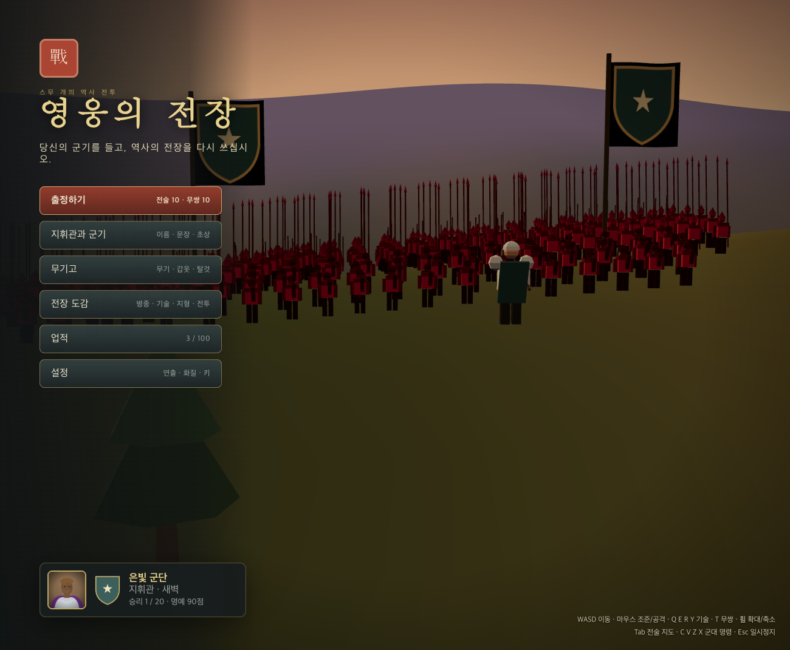
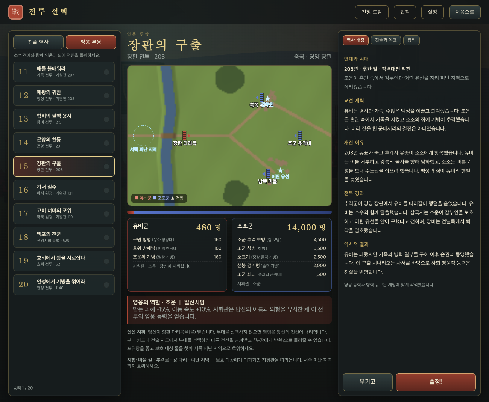
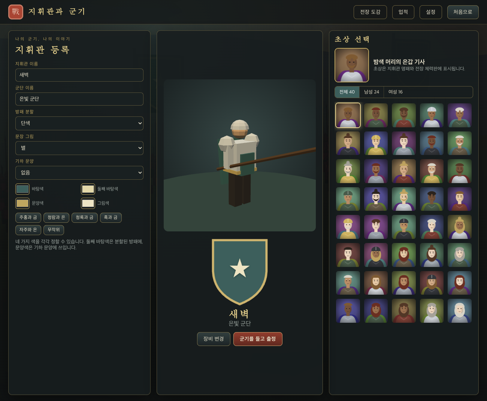
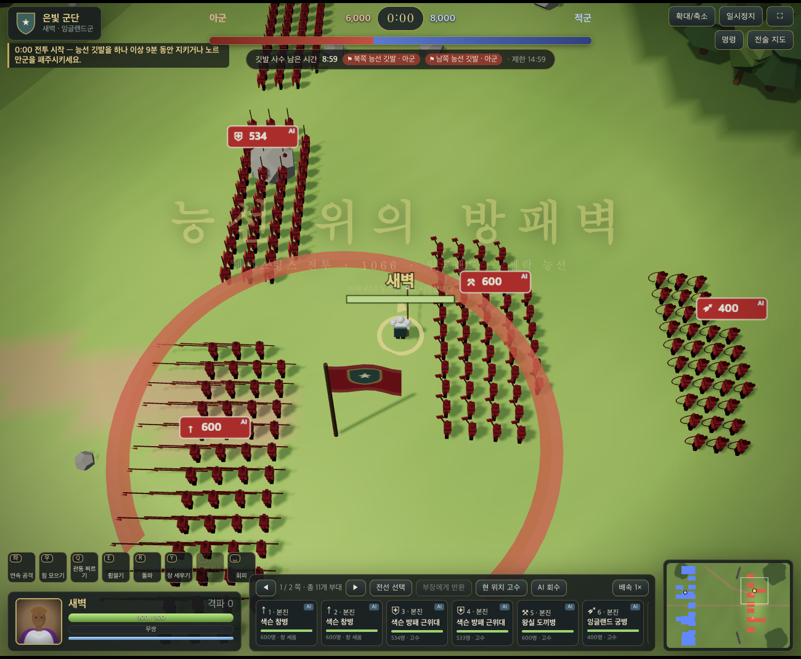
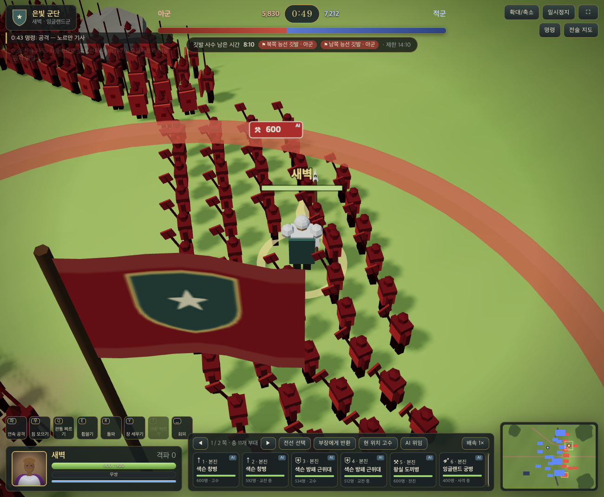
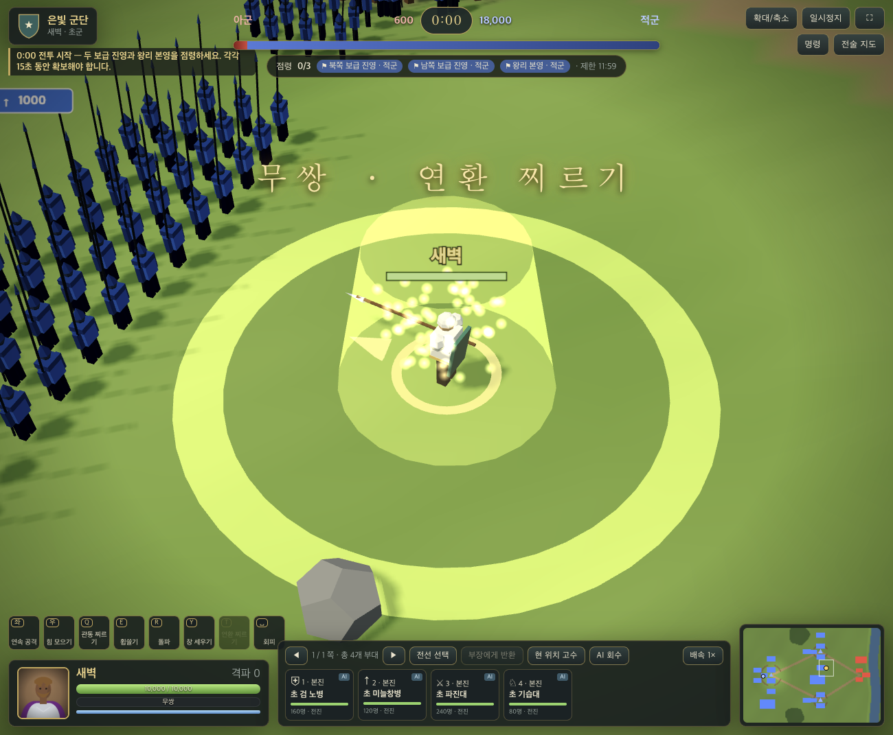
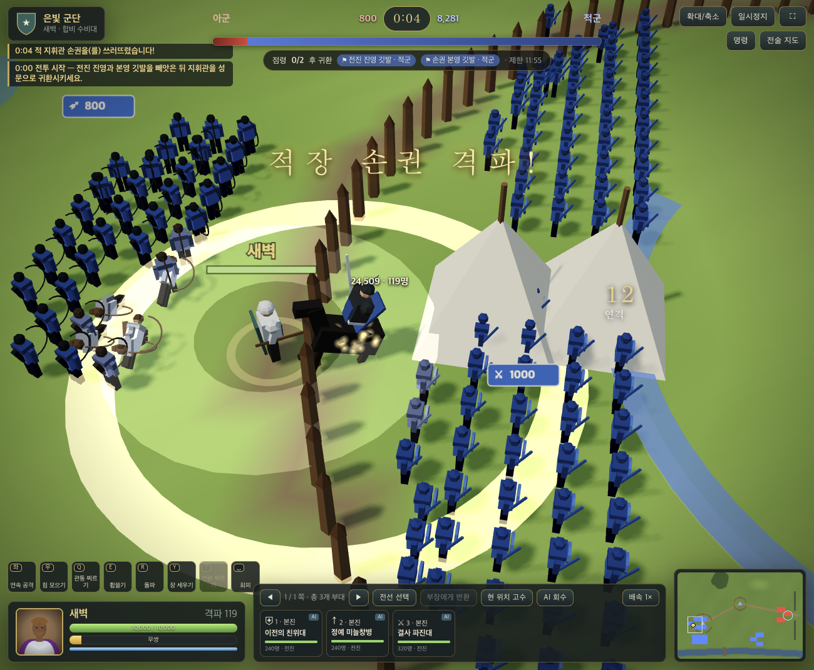
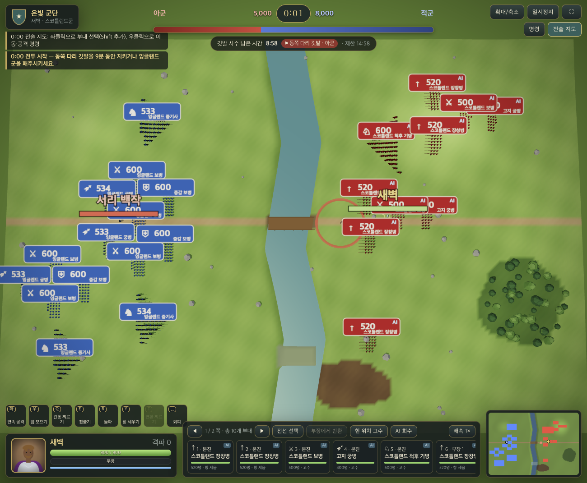
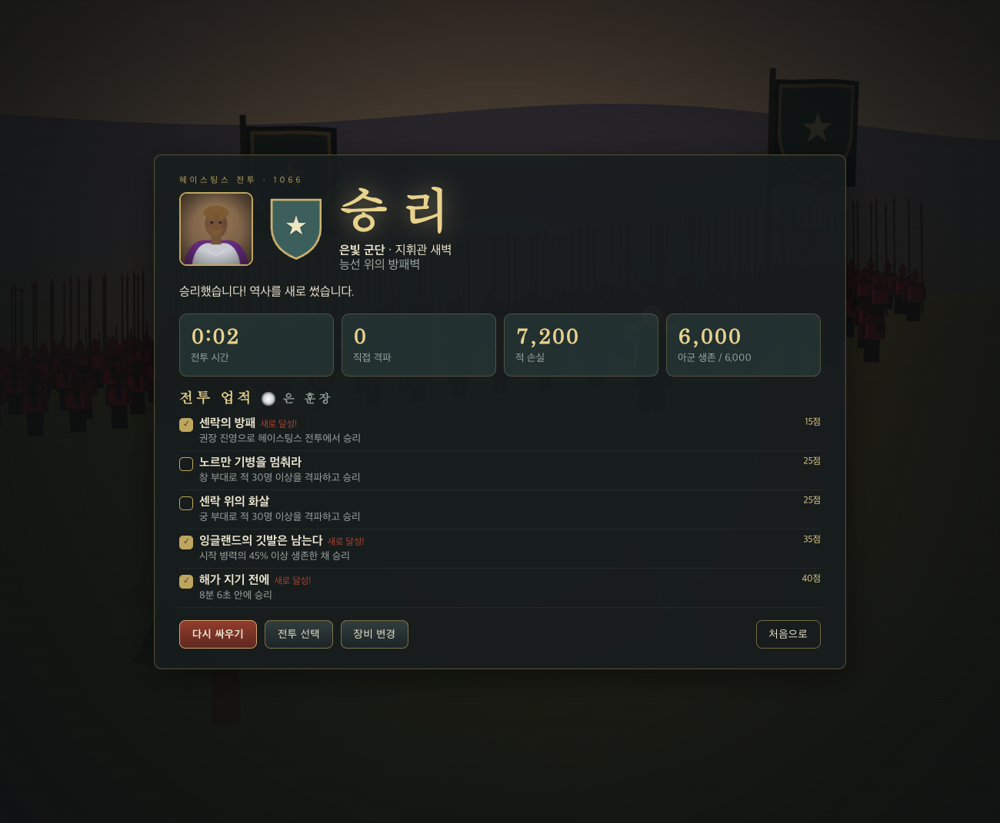

# 영웅의 전장 — 스무 개의 역사 전투

three.js 로 만든 3D 실시간 액션·부대 지휘 게임입니다. 지휘관이 되어 직접 싸우는 동시에 여러 부대를 지휘해 역사 속 전투 20개를 치릅니다. 모든 화면은 한국어이며, 모델·문장·초상·효과음은 외부 에셋 없이 코드로 생성합니다.

**▶ 바로 플레이: <https://gyuha.com/heroes-battlefield/>**



---

## 스크린샷

| 전투 선택 | 지휘관과 군기 |
|---|---|
|  |  |

| 전투 화면 | 확대(휠·연출) |
|---|---|
|  |  |

| 무쌍 연출(확대·슬로모션) | 적장 격파 연출 |
|---|---|
|  |  |

| 전술 지도 | 전투 결과 |
|---|---|
|  |  |

---

## 주요 기능

- **전투 20개**: 전술 역사 10개(열세의 병력으로 지형을 이용) · 영웅 무쌍 10개(소수 정예와 함께 적진 돌파)
- **지휘관 전투**: 4연타 공격, 힘 모으기 강공격, 무기 계열(검과 방패·대검·장병기·활·쇠뇌·법구)별 기술 Q·E·R·Y, 무쌍 필살기, 회피, 질주
- **부대 지휘**: 본진·부장 전선, 부대 선택·인수·반환, 명령(전방 정렬·공격·돌격·고수·AI 위임), 진형 5종, 전술 지도
- **전장 규칙**: 병종 19종, 창 세우기의 돌격 저지, 방패, 측면·후방 공격, 고지, 숲·진흙·강·다리, 사기와 패주
- **승리 조건 7종**: 깃발 유지 · 동시 유지 · 차례 점령 · 점령 후 귀환 · 패주 · 적장 격파 · 호위
- **카메라**: 휠·슬라이더 확대/축소(0.45~2.6배), 전술 지도, 전투 시작·무쌍·거점 점령·적장 격파·위기·승패 때 자동 확대·궤도 회전·슬로모션
- **성장과 꾸미기**: 업적 100개·명예 점수·훈장, 문장 편집, 초상 40종, 무기고(무기·갑옷·투구·망토·탈것·마갑)
- **편의**: 키 재지정, 연출·화질·피해 숫자·난이도·음량 설정, 터치(모바일 가로) 모드, 브라우저 자동 저장

---

## 실행 방법

### 요구 사항

- Node.js 18 이상
- WebGL 을 지원하는 브라우저(Chrome·Edge·Safari·Firefox 최신판)

### 로컬에서 실행

```bash
git clone https://github.com/gyuha/heroes-battlefield.git
cd heroes-battlefield
npm install
npm run dev
```

브라우저에서 터미널에 표시된 주소(기본 `http://localhost:5173`)를 엽니다.

### 그 밖의 명령

| 명령 | 설명 |
|---|---|
| `npm test` | 규칙·저장·20개 전투 헤드리스 테스트 |
| `npm run sim` | 전투 20개 헤드리스 시뮬레이션(균형 점검). 특정 전투만: `npm run sim -- 1 11` |
| `npm run build` | 배포용 빌드 → `dist/` |
| `npm run preview` | 빌드 결과를 로컬에서 미리보기 |

### 배포

`main` 브랜치에 푸시하면 GitHub Actions(`.github/workflows/deploy.yml`)가 테스트 → 빌드 → GitHub Pages 배포를 자동으로 수행합니다. `vite.config.js` 는 하위 경로에서도 동작하도록 상대 경로로 빌드합니다.

---

## 조작

| 구분 | 키 |
|---|---|
| 이동 · 질주 | W A S D · Shift |
| 공격 · 힘 모으기 | 좌클릭 · 우클릭 길게 눌렀다 떼기 |
| 기술 · 무쌍 · 회피 | Q E R Y · T · 스페이스 |
| 군대 명령 | C 전방 정렬 · V 커서 공격 · Z 돌격 · X 커서 고수 · B AI 위임/회수 |
| 진형 | F 방진 · G 원진 · H 쐐기진 · [ 장사진 · ] 공심방진 |
| 부대 선택 | \` 전선 선택 · 1–9 부대 선택(Shift 추가) · 0 선택 해제 |
| 화면 | 휠 확대/축소 · Tab 전술 지도 · Esc 일시정지 · F1 도움말 · F3 성능 표시 |

전술 지도에서는 좌클릭으로 부대를 선택하고 우클릭으로 이동·공격을 명령합니다. 모든 키는 **설정 → 키 설정**에서 바꿀 수 있습니다.

---

## 프로젝트 구성

```
├─ index.html · vite.config.js · package.json
├─ public/                 정적 파일(파비콘)
├─ src/
│  ├─ main.js              앱 진입, 화면 전환, 메인 루프
│  ├─ core/                전투 규칙(순수 함수), 저장 데이터, 효과음 합성
│  ├─ data/                병종 · 무기와 기술 · 전투 20개 데이터
│  ├─ game/                지도·경로 탐색, 부대·대형, 지휘관, 전선 AI, 전투 진행
│  ├─ gfx/                 렌더러, 절차적 모델, 문장·초상, 효과, 카메라 연출, 메뉴 배경
│  └─ ui/                  메뉴·전투 선택·도감·결과·전투 HUD
├─ tests/                  단위·헤드리스 전투 테스트
├─ scripts/sim-run.mjs     헤드리스 시뮬레이션
├─ docs/                   설계·레퍼런스·검증 문서
└─ .github/workflows/      GitHub Pages 배포
```

시뮬레이션(`core/`, `data/`, `game/`)은 three.js·DOM 에 의존하지 않아 Node 에서 그대로 테스트할 수 있습니다. 자세한 구조와 전투 공식, 카메라 연출 설계는 [docs/README.md](docs/README.md)와 [docs/06-재구현-설계.md](docs/06-재구현-설계.md)를 참고하세요.

## 사용 기술

three.js 0.180 · Vite 6 · Web Audio API · `node:test`
