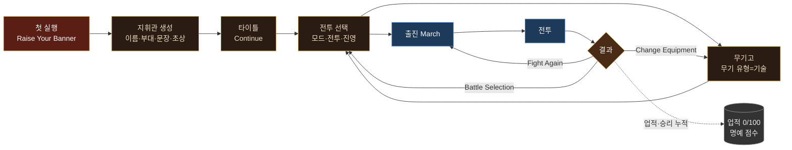
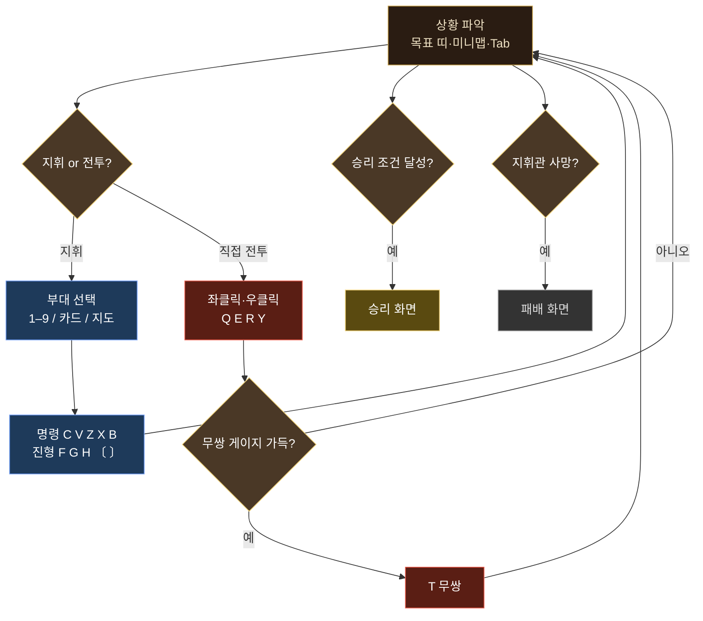

# 01. 원본 개요

> 근거: 브라우저 세션의 itch.io 페이지 관찰, `research/index.html`, `research/launch.js`, `research/original-menu.png`, `research/original-ready.png`, `research/g-01-start.png`, `docs/raw/briefings.json`, `docs/raw/codex.json`

## 1. 게임 정체

**Song of Ashes｜灰燼之歌：Historical Battles Demo**는 JUMO GAMES가 itch.io에 공개한 브라우저 게임이다. 장르는 두 가지가 섞여 있다.

- **실시간 액션**: 플레이어는 지휘관 한 명을 직접 조작한다(WASD 이동, 마우스 조준·공격, Q/E/R/Y 스킬, T 무쌍, Space 회피).
- **군단 지휘**: 같은 전장에서 수천 명 규모의 아군 부대(company)를 유닛 카드, 전선(front), 부관(lieutenant), 진형, 전술 지도로 지휘한다.

역사 전투 20개를 다룬다. 동아시아(진·한·삼국·남북조·당·송)와 유럽·지중해(헤이스팅스, 스털링 다리, 아쟁쿠르, 칸나에, 배넉번, 이소스) 전투가 섞여 있다. 플레이어는 직접 만든 지휘관(이름, 부대 이름, 문장, 초상화, 외형 장비)으로 모든 전투에 나간다. 메뉴 문구는 "Twenty battles. One banner of your own."(스무 전투, 나만의 군기 하나)이다.

## 2. 페이지 메타데이터

관찰일 2026-10-23 기준 itch.io 페이지 정보:

| 항목 | 값 |
|---|---|
| 제목 | Song of Ashes｜灰燼之歌：Historical Battles Demo |
| 제작 | JUMO GAMES (itch 계정 `hank1105`) |
| URL | https://hank1105.itch.io/heroes-battlefield-demo |
| 게임 iframe | https://html-classic.itch.zone/html/19955940/index.html |
| 게시 | "Published 1 day ago" (관찰 시점 기준 상대 표기. 정확한 날짜는 미확인) |
| 상태 | In development |
| 플랫폼 | HTML5 |
| 입력 | Keyboard, Mouse, Smartphone |
| AI 사용 고지 | AI Assisted (Code, Graphics, Text) |
| 언어 | English, Traditional Chinese(繁體中文) |
| HTML `<title>` | `Song of Ashes \| Historical Battles` |
| `application-name` | `灰燼之歌` |
| 검색 차단 | `<meta name="robots" content="noindex,nofollow,noarchive">` |

## 3. 기술 관찰

### 3.1 렌더링 구조

`research/index.html`에서 확인한 구조:

| 요소 | 역할 | 근거 |
|---|---|---|
| `canvas#gl` | 메인 WebGL 캔버스. 화면 전체(`position: fixed; inset: 0`), `image-rendering: pixelated`, 커서 `crosshair` | index.html CSS |
| `div.vign` | 비네트(가장자리 어둡게) 레이어 | index.html |
| `canvas#ov` | 오버레이 캔버스. `pointer-events: none`. 유닛 태그, 지휘관 이름표 같은 2D 표시용으로 추정 | index.html CSS |
| DOM HUD (`#hud`) | 상단 병력 막대, 로그, 영웅 패널, 스킬, 유닛 카드, 명령 패널, 미니맵 등은 모두 HTML/CSS | index.html |
| `#banner` | 화면 중앙의 큰 문구(전투 제목, 명령, 무쌍) | index.html CSS (`.title`, `.order`, `.red`, `.musou` 클래스) |
| `#perf` | F3 성능 표시(우상단 monospace, 기본 숨김) | index.html CSS |

화면은 **도트(픽셀 아트) 스프라이트를 위에서 내려다보는 시점**으로 그린다. 병사 한 명 한 명을 개별 스프라이트로 그리며 한 화면에 수천 명이 보인다(`research/g-07-battle-start.png`, `research/original-battle.png`). 3D 지형 메시를 쓰는지 2D 타일인지는 미확인이다. 스크린샷상 지형은 위에서 본 평면 타일에 능선 벽, 길, 숲 덩어리가 그려진 형태다.

### 3.2 에셋과 로더

- 로딩 화면에 `下載素材 / Downloading · 0.0 / 29.1 MB`가 표시된다. 전체 에셋 크기는 **29.1 MB**이다(`research/original-menu.png`).
- 에셋은 **해시 이름의 암호화된 `.bin` 파일**이라 정적 분석이 불가능하다.
- `research/launch.js`는 난독화된 로더이며 앞부분에 **pako**(zlib 해제 라이브러리, MIT, Vitaly Puzrin·Andrei Tuputcyn) 라이선스 주석이 있다. 압축 해제 후 복호화하는 구조로 추정한다.
- 로딩 텍스트: `載入中 / Loading · N%`, 세부 `整備兵馬 / Preparing armies`, 실패 시 `重新載入 / Retry` 버튼(`#load-retry`, 기본 hidden).
- 셸 프리로더 문구: `灰燼之歌` / `軍旗初展・兵馬集結`.
- 키아트 `img/keyart.webp`를 preload한다.
- CSS 파일: `css/demo.css`, `css/demo-ornaments.css`, `css/demo-handheld.css`(휴대폰 대응으로 추정), `css/i18n.css`, `css/loading.css`, `css/demo-journal.css`.
- itch.io 표준 `htmlgame.js`를 로드한다.

### 3.3 저장소와 다국어

- 언어 설정 localStorage 키: **`song-of-ashes.language.v1`**. 값이 없으면 `auto`이다.
- `auto`일 때 `navigator.languages`를 순회해 `zh*` → `zh-Hant`, `en*` → `en`으로 정하고, 둘 다 없으면 `en`을 쓴다.
- `zh-Hant`일 때만 폰트 `fonts/huninn.css`, `fonts/notoseriftc.css`를 추가로 로드한다.
- 키 바인딩은 "이 브라우저에 저장"된다(키 설정 화면 안내문). 저장 키 이름은 미확인이다.
- 지휘관 정보, 외형, 승리 기록(`Victories 0 / 20`), 업적 진행도도 브라우저에 보존되는 것으로 보인다("Your appearance carries across battles"). 저장 키와 형식은 미확인이다.
- 원본 영어 UI에는 번역이 덜 된 중국어가 남아 있다(`擊破`, `連擊`, `Hold現位`, `左鍵 / 右鍵`, `滾輪`, `固定按鍵`, 키 설정 안내문 `pts按鈕後按下新的鍵; 按到已Use 的鍵會Automatic互換`). 단어 단위 치환 방식의 번역 시스템으로 추정한다. 재구현에서는 전부 한국어로 옮긴다.

### 3.4 모바일 대응

- 메타 viewport에 `user-scalable=no, viewport-fit=cover`가 있다.
- 설정의 **Interface Mode**는 `Automatic / Desktop / Phone Landscape` 세 가지다.
- 설정 안내문: "Automatic selects the layout for your screen and device. Phone landscape enables touch movement, skills, and army controls. Rotate your phone when held upright."(자동은 화면과 기기에 맞게 배치를 고른다. 휴대폰 가로 모드는 터치 이동, 스킬, 군대 조작을 켠다. 세로로 들고 있으면 휴대폰을 돌려라.) (`research/g-04-settings.png`)
- 무쌍 규칙 문구 "Press T or tap Musou"는 터치 버튼이 있음을 보여준다.
- 터치 UI의 실제 배치는 관찰하지 못했다(미확인).

### 3.5 색상 팔레트 (CSS 변수)

재구현 UI 톤을 맞출 때 참고할 값이다.

| 변수 | 값 | 용도 |
|---|---|---|
| `--ink` | `#120e0c` | 배경 잉크 |
| `--panel` | `rgba(18,13,11,.86)` | 패널 배경 |
| `--gold` | `#c9a24a` | 테두리 금색 |
| `--gold2` | `#f0d27a` | 강조 금색(제목, 시간) |
| `--cinnabar` | `#b8322c` | 주홍(경고 로그 등) |
| `--paper` | `#efe2c4` | 기본 글자색 |
| `--dim` | `#a8987a` | 흐린 글자 |
| `--blue` | `#4a7ad8` | 청군 |
| `--red` | `#d8443a` | 홍군 |
| 아군 막대 | `#e85a4a → #a8281e` 그라데이션 | |
| 적군 막대 | `#6a98f0 → #2a4ea8` 그라데이션 | |
| HP 게이지 | `#9ae070 → #3a8a2a` | |
| 무쌍 게이지 | `#ffe48a → #d89a20`, 가득 차면 `#fff6c8 → #ffb020` + 깜빡임 | |
| 보조 게이지(`#st`) | `#a8e0ff → #3a88c8` | 스태미나로 추정 |
| `#mp` 게이지 | `#d8b0ff → #7a4ac8` | 기본 숨김. 법구용 마나로 추정 |

## 4. 두 가지 모드

메뉴에 "10 Tactical Battles · 10 Heroic Battles"라고 적혀 있다. 전투 선택 화면 왼쪽에 `Tactical History` / `Heroic Musou` 탭이 있다(`research/g-05-continue.png`).

| 구분 | 전술 역사 (Tactical History) | 영웅 무쌍 (Heroic Musou) |
|---|---|---|
| 전투 번호 | 01–10 | 11–20 |
| 아군 규모 | 5,000–9,000명 | 440–800명 |
| 적군 규모 | 8,000–14,000명 | 12,000–20,000명 |
| 지휘관 성능 | "Your commander is vulnerable and deals 40% of baseline damage. Stay alive and win through troops and terrain."(지휘관은 취약하고 기준 피해의 40%만 준다. 살아남아 병력과 지형으로 이겨라.) 헤이스팅스 실측 HP 900/900 | "Commander: 10,000 HP and 60% damage reduction, accompanied by a small elite guard. Health recovers out of combat."(HP 10,000, 피해 감소 60%, 소수 정예 호위, 비전투 시 체력 회복) 거록 실측 HP 10000/10000 |
| 진영 선택 | 두 진영 모두 선택 가능(`Lead X Army · Recommended` / `Lead Y Army`) | 브리핑에 진영 선택 문구가 없다. 추천 진영 고정으로 추정 |
| 전선·부관 | 전선 2–3개, 부관 1–2명 ("Front commands: …") | 브리핑에 전선 명령 문구가 없다. 유닛 카드는 전부 `Main`(거록 실측) |
| 영웅 역할 | 없음 | `Hero's Role · 인물 ｜ 특성명` — "Your commander keeps your name and appearance, with the hero's abilities for this battle."(이름과 외형은 유지하고 이 전투에서만 영웅의 능력을 쓴다) |
| 무쌍 안내 | 교범의 공통 규칙만 있음 | 브리핑에 "Two to three full skill rotations into a dense enemy formation can fill Musou. Misses add nothing, and repeat hits on the same enemy within one skill count once."(밀집한 적에게 스킬을 2~3바퀴 돌리면 무쌍이 찬다. 빗나가면 0이고, 한 스킬 안에서 같은 적을 여러 번 맞혀도 1회로 친다) 추가 |
| 패배 조건 문구 | "Your commander's death means defeat." 명시 | 브리핑에 이 문장이 없다. 지휘관 사망 시 패배인지 미확인 |

> 근거: `docs/raw/briefings.json`(전투별 `tab` 필드가 `Tactical History` 또는 `Heroic Musou`), `research/g-07-battle-start.png`(900/900), `research/original-battle.png`(10000/10000)

## 5. 핵심 루프

### 5.1 메타 루프 (메뉴)

처음 실행하면 지휘관을 만들고, 이후에는 전투를 고르고 장비를 맞춘 뒤 출진한다. 전투가 끝나면 결과 화면에서 재도전, 전투 선택, 장비 변경으로 돌아간다. 업적(전투당 5개, 총 100개)과 승리 수(`Victories N / 20`)가 누적된다.

### 5.2 전투 루프

전투 안에서는 지휘관 직접 전투와 군단 지휘를 번갈아 한다. 전술 전투에서는 지휘관이 약하므로 지휘가 중심이고, 영웅 전투에서는 지휘관이 강하므로 직접 돌파가 중심이다.

1. **상황 파악**: 상단 목표 띠(깃발 상태와 남은 시간), 미니맵, 전술 지도(Tab)로 확인한다.
2. **지휘**: 유닛 카드나 숫자 키로 부대를 고르고 명령(C/V/Z/X/B)과 진형(F/G/H/[/])을 내린다. 아무것도 고르지 않으면 명령은 내 전선에 적용된다.
3. **전선 관리**: 부관이 맡은 전선의 부대를 선택해 직접 지휘하고(인수), 필요 없으면 `Delegate Back`으로 부관에게 돌려준다.
4. **직접 전투**: 좌클릭 연속 공격, 우클릭 기 모으기, Q/E/R/Y 스킬로 적을 쳐서 무쌍 게이지를 채우고 T로 무쌍을 쓴다. 위험하면 Space로 회피한다.
5. **목표 달성**: 깃발 확보·유지, 적 궤주, 적 지휘관 격파, 호위, 귀환 등 전투별 조건을 채운다.
6. **종료**: 승리 조건 달성 또는 패배(지휘관 사망 등) → 결과 화면.

## 6. 실측 사례: 헤이스팅스 전술 전투

- 플레이어 진영: English Army 6,000명(추천 진영), 상대 Norman Army 8,000명.
- 시작 로그: `00:00 English: hold at least one ridge flag for nine minutes, or rout the Normans.`
- 목표 띠: `Flags North Ridge Flag: Defenders South Ridge Flag: Defenders | 8:54` → 약 0:37에 `North Ridge Flag: Contested South Ridge Flag: Contested | 8:22`.
- 지휘관이 홀로 노르만 전열에 돌격했다가 **0:45에 전사** → 패배 화면 "Your commander has fallen. The army has lost its leader."(지휘관이 쓰러졌다. 군대가 지도자를 잃었다.)
- 결과 통계: Battle Time 0:45 / Personal Kills 0 / Enemy Losses 446 / Allied Survivors 5,447.
- 0:37 시점 HUD: 아군 5,906 / 적 7,840, 지휘관 HP는 여전히 900/900으로 표시됐다. 8초 뒤 사망한 것으로 보아 피격 시 HP가 빠르게 줄었다고 추정한다.

> 근거: `research/g-07-battle-start.png`, `research/g-14-fight2.png`, `research/g-15-state.png`

## 7. 재구현 관점의 요약

| 항목 | 원본 | 재구현 메모 |
|---|---|---|
| 렌더러 | WebGL 픽셀 스프라이트 + 2D 오버레이 캔버스 + DOM HUD | three.js로 대체. HUD는 DOM 유지가 자연스럽다 |
| 리소스 | 암호화 `.bin` 29.1 MB | 신규 리소스로 전면 교체(원본 에셋 사용 불가) |
| 언어 | 영어·번체 중국어(혼합 표기 있음) | 한국어 전용, 혼합 표기 없음 |
| 저장 | localStorage | 같은 방식 권장. 키 이름은 새로 정한다 |
| 입력 | 키보드·마우스·휴대폰 가로 모드 | 05 문서 참조 |
