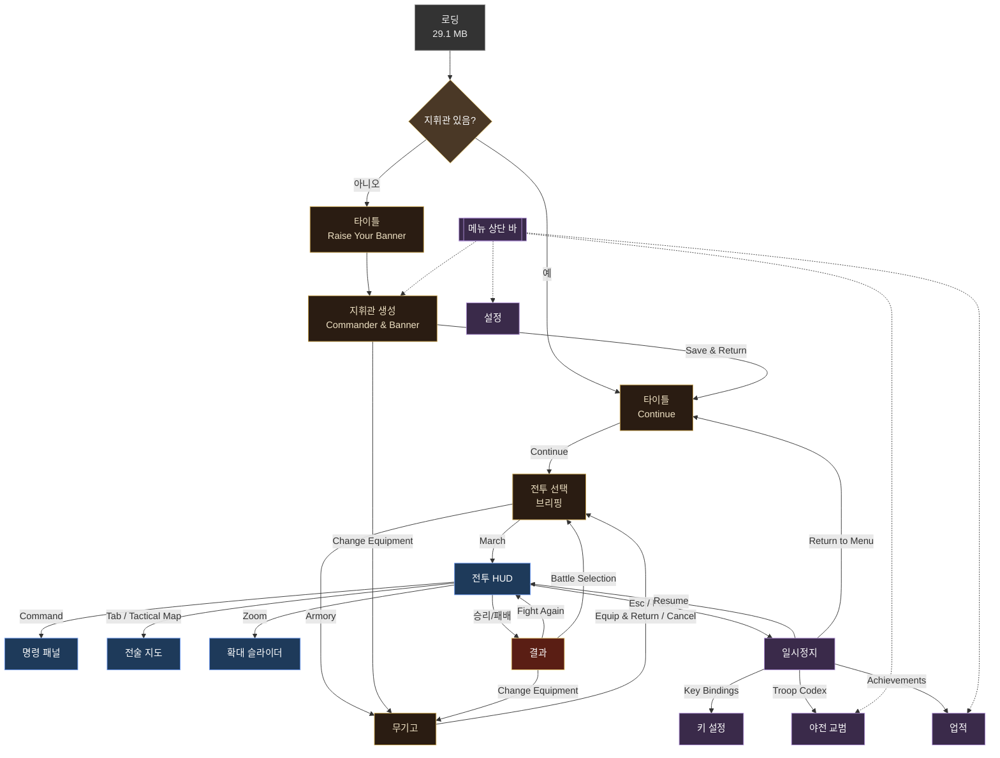

# 02. 화면 구성

이 문서는 원본의 모든 화면을 영역, 요소, 동작 순서로 정리한다. 각 화면 머리에 근거 스크린샷을 단다. 좌표는 1300×1071 캡처 기준의 대략적 위치이며 픽셀 단위 수치가 아니다.

---

## 0. 화면 흐름

첫 실행에서는 로딩 뒤 `Raise Your Banner` 타이틀이 나오고, 지휘관을 만들어야 메뉴 상단 바에 Codex·Achievements·Commander & Banner 버튼이 생긴다. 이후에는 타이틀의 `Continue`로 전투 선택에 들어간다. 전투 선택에서 무기고를 오갈 수 있고 `March`로 전투에 들어간다. 전투 중 Esc로 일시정지 메뉴를 열면 키 설정, 병종 도감, 업적을 보거나 메뉴로 돌아갈 수 있다. 전투가 끝나면 결과 화면에서 재도전, 전투 선택, 장비 변경으로 갈 수 있다. 도감·업적·설정은 메뉴 상단 바 어디서든 모달로 열린다.



- 결과 화면의 `Change Equipment`가 무기고로 가는지 지휘관·군기 화면으로 가는지는 미확인이다. 버튼 이름이 지휘관 화면의 `Change Equipment`와 같아 무기고로 가는 것으로 추정한다.
- 일시정지의 `Return to Menu`가 타이틀로 가는지 전투 선택으로 가는지는 미확인이다.

---

## 1. 로딩 화면

> 근거: `research/original-menu.png`, `research/index.html`(`#loading`)

| 영역 | 요소 |
|---|---|
| 배경 | 전체 화면 키아트(기사, 엘프 궁수, 성, 대군. 타이틀과 같은 그림) |
| 상단 중앙 | 큰 로고 `灰燼之歌` |
| 중앙 하단 카드 | 소제목 `灰燼之歌 · HISTORICAL BATTLES`, 제목 `Song of Ashes`, 진행 막대(금색 그라데이션 `#load-fill`), `載入中 / Loading · 0%`, 세부 `下載素材 / Downloading · 0.0 / 29.1 MB` |
| 숨김 | `重新載入 / Retry` 버튼(실패 시 표시로 추정), `整備兵馬 / Preparing armies` 단계 문구 |

동작: 다운로드량과 퍼센트가 갱신되고, 완료되면 타이틀로 넘어간다. 단계 문구의 종류(다운로드 → 준비)는 HTML에 있는 두 문구만 확인됐다.

---

## 2. 타이틀 / 메인 메뉴

> 근거: `research/original-ready.png`(첫 실행), `research/g-01-start.png`(지휘관 생성 후)

### 2.1 레이아웃

| 영역 | 첫 실행 | 지휘관 생성 후 |
|---|---|---|
| 상단 바 좌측 | 로고 `戰` 인장 + `Song of Ashes` / `Twenty Historical Battles` | 동일 |
| 상단 바 중앙 | 문구 `Raise a banner · Muster · March` | 지휘관 명패(초상화, 문장, 부대 이름 `은빛 군단`, `Commander · 새벽`) + `Codex`, `Achievements`, `Commander & Banner` 버튼 |
| 상단 바 우측 | `Settings` | `Settings` |
| 본문 | 키아트 + `灰燼之歌` 로고 | 동일 |
| 본문 하단 | `HISTORICAL BATTLES` / `Song of Ashes` / `Twenty battles. One banner of your own.` | 동일 |
| 주 버튼 | `Raise Your Banner` | `Continue` |
| 버튼 옆 | `10 Tactical Battles · 10 Heroic Battles` | 동일 |
| 하단 띠 좌측 | `WASD Move · Mouse Aim / Attack · Q E R Skills · T Musou` | 동일 |
| 하단 띠 우측 | `Twenty battles · Your own banner` | 동일 |

### 2.2 동작

- `Raise Your Banner` → 지휘관 생성 화면(3장).
- `Continue` → 전투 선택(5장).
- 상단 바 버튼은 각 화면을 모달로 연다. 도감과 업적은 본문 위에 어두운 막을 깔고 큰 패널로 뜬다(`research/g-02-codex.png`).

---

## 3. 지휘관과 군기 (Commander & Banner) / 지휘관 생성

> 근거: `research/original-customize.png`, `docs/raw/commander-banner.json`

### 3.1 레이아웃 (3단)

| 영역 | 요소 |
|---|---|
| 좌측 머리 | `YOUR BANNER, YOUR STORY`, 제목 리본 `Raise Your Banner`, 설명 "Name your commander and carry your banner into the battles of history." |
| 좌측 패널 `Create Commander` | `Commander Name` 입력(placeholder `Enter commander name`), `Company Name` 입력(placeholder `Enter company, guard, or regimen…`, 화면에서 잘림), `Banner & Crest`: 방패 미리보기 + 드롭다운 3개(문장 분할 / 문장 도형 / 오디너리), 색 4개(Field Color, Second Field Color, Ordinary Color, Charge Color: 색 견본 + hex 입력), 프리셋 버튼 6개(Red & Gold, Blue & Silver, Green & Gold, Black & Gold, Purple & Silver, Random), 안내문 |
| 중앙 | 지휘관 전신 미리보기(픽셀 스프라이트), 이름 리본(`Unnamed Commander` / `A banner waiting to rise`, 입력하면 이름으로 바뀜), 아래 `Change Equipment` 버튼 |
| 우측 패널 `Choose Portrait` | 선택된 초상(기본 `Brown-haired Plate Knight`) + 설명 "Your portrait appears on the commander nameplate and battlefield health panel.", 필터 탭 `All 40` / `Male 24` / `Female 16`, 4열 스크롤 그리드, 하단 안내 "You can choose again in Commander & Banner. Equipment appearance is changed separately." |
| 하단 | `Save & Return` 버튼(텍스트 덤프에서 확인. 스크린샷에서는 스크롤 아래) |

### 3.2 기본값과 규칙

- 기본 색: Field `#923f32`, Second Field `#e3b34a`, Ordinary `#e3b34a`, Charge `#e3b34a`.
- 기본 선택: `Solid` / `Lion Rampant` / `None`.
- 안내문: "Set each of the four colors independently. The second field color appears with a divided shield; the ordinary color appears with a geometric charge."(네 색을 따로 정한다. 두 번째 바탕색은 분할 방패에서, 오디너리 색은 기하 도형에서 보인다.)
- 전체 옵션 목록은 04 문서 9장.
- 이름 길이 제한, 금칙어, 빈 이름 처리 규칙은 미확인이다.

---

## 4. 무기고 (Armory)

> 근거: `research/g-06-armory.png`, 브라우저 세션 관찰

| 영역 | 요소 |
|---|---|
| 좌측 패널 | `ARMORY`, 리본 `Prepare for Battle`, "Choose the weapons and armor your commander will wear into battle.", 소제목 `Appearance Equipment`, 설명 "Weapon types determine moves and skills: sword and shield, greatsword, polearm, bow or crossbow, and focus. Equipment within a type has no stat advantage. The battle determines health, damage, and defense.", "Mix equipment freely. No currency or unlock is required." |
| 중앙 | 지휘관 미리보기, 이름 리본(`새벽` / `은빛 군단`), 아래 `↰ Rotate` / `Rotate ↱` 버튼 |
| 우측 패널 `Weapons & Armor` | 드롭다운 6개: `Weapon`, `Armor`, `Helmet`, `Cloak`, `Mount`, `Barding`, 안내 "Your appearance carries across battles. Changes are applied to your commander in battle.", 버튼 `Equip & Return`(주), `Cancel Changes` |

- 스크린샷 선택값: Weapon `Sacred Cavalry Lance`, Armor `Greatsword Armor III`, Helmet `Heavy Cavalry Helmet III`, Cloak `Oathbound Cloak`, Mount `On Foot`, Barding `No Barding`(Mount가 On Foot일 때 비활성처럼 흐리게 표시).
- 항목 목록은 04 문서 10장.
- 회전은 버튼 클릭 단위이며, 회전 각도 단위와 드래그 회전 여부는 미확인이다.

---

## 5. 전투 선택 (브리핑)

> 근거: `research/g-05-continue.png`, `docs/raw/briefings.json`

### 5.1 레이아웃 (3단)

| 영역 | 요소 |
|---|---|
| 좌측 목록 | 탭 `Tactical History` / `Heroic Musou`. 전투 카드 세로 목록(번호 `01`, 제목 2줄, `Battle of Hastings · 1066`). 선택 카드는 금색 테두리. 스크롤 |
| 중앙 머리 | 모드 태그(`Tactical History`), 제목 리본(`Shield Wall on the Ridge`), 왼쪽 `Battle of Hastings · 1066`, 오른쪽 `England · Senlac Ridge` |
| 중앙 지도 | 지형 미리보기(픽셀 지도: 능선 윤곽, 길, 숲, 양군 배치 점, 깃발 위치와 이름 `North Ridge Flag`, `South Ridge Flag`). 범례 `■ English Army ■ Norman Army ◇ Key Position` |
| 중앙 편성 | 양군 패널 2개: 군 이름, 총병력(`6,000troops`), 부대 목록 `부대명〔병종〕병력`, `Commander · 이름 ｜ You command this army` |
| 중앙 진영 선택 | `Lead English Army · Recommended` / `Lead Norman Army` 버튼(전술 전투만) |
| 중앙 하단 | 전선 명령 문단 + 지형 문단(스크롤) |
| 우측 패널 `Historical Background` | Date & Era, The Opposing Armies, Why They Fought, The Battle, Historical Outcome, Recommended Side(+ 지휘관 성능 문장), Tactics, Five Battle Achievements, Victory Conditions, (영웅 전투) 무쌍 안내, Historical Source |
| 우측 하단 | `Armory` 버튼, `March` 버튼(주), 안내 "Equipment changes appearance and moves. Battle rules determine strength." |
| 머리 | `Victories 0 / 20` 승리 카운터(텍스트 덤프에서 확인) |

### 5.2 전술 전투와 영웅 전투의 차이

| 항목 | 전술 | 영웅 |
|---|---|---|
| 진영 선택 버튼 | 있음 | 없음(브리핑 텍스트에 `Lead` 없음) |
| 전선 명령 문단 | 있음 | 없음 |
| `Hero's Role` 문단 | 없음 | 있음 |
| 무쌍 안내 문단 | 없음 | 있음 |
| 지휘관 성능 문장 | 취약, 기준 피해 40% | HP 10,000, 피해 감소 60%, 정예 호위, 비전투 회복 |

### 5.3 동작

- 목록 카드를 누르면 중앙·우측 내용이 그 전투로 바뀐다.
- 진영 버튼 선택 상태는 금색 배경으로 강조된다. 비추천 진영을 고르면 브리핑(전술, 승리 조건)이 바뀌는지는 미확인이다.
- `March` → 전투 시작. `Armory` → 무기고.

---

## 6. 야전 교범 (Codex / Field Manual)

> 근거: `research/g-02-codex.png`, `docs/raw/codex.json`

| 영역 | 요소 |
|---|---|
| 머리 | `Song of Ashes · Battle Chronicle` / 제목 `Field Manual`, 우측 `Return` |
| 1단 탭 | `Troops`, `Weapons & Skills`, `Terrain`, `Battles`, `Achievements` |
| 2단 탭(Troops) | `Battle Troops`, `Advanced Troops`, `All Troops`. 우측에 현재 전투 이름(`Shield Wall on the Ridge`) |
| 좌측 목록 | 병종 아이콘 + 이름 + `Tier I/II/III`. 선택 항목 강조. 스크롤 |
| 우측 상세(양피지 카드) | 아이콘, Tier, 이름 / 능력치 2×2(HP per Soldier, Damage per Hit 또는 Missile Damage, Damage Reduction, Melee Reach 또는 Range) / Abilities / Command Advice / Weaknesses / Battle Roster(현재 전투에서 이 병종을 쓰는 부대와 병력, 없으면 "This troop type is not deployed in this battle.") |

- `Battle Troops`는 현재 선택한 전투(헤이스팅스)에 나오는 8개 병종을 보여준다(방패 보병, 창병, 장궁병, 돌격 기병, 습격 기병, 철벽 근위대, 철부 노병, 미늘창 근위대).
- `Advanced Troops`는 Tier II·III로 추정한다(미확인).
- `Weapons & Skills` 탭: 무기 유형별 카드(설명, Q/E/R/Y, Musou).
- `Terrain` 탭: 4항목.
- `Battles` 탭: 전투별 역사(시대, 맞선 군대, 이유, 경과, 결과).
- `Achievements` 탭: 업적 화면(7장)과 같다. 이 탭에서는 머리 제목이 `Heroic Deeds`로 바뀐다.
- 일시정지 메뉴의 `Troop Codex`도 이 화면을 연다.

---

## 7. 업적 (Achievements / Heroic Deeds)

> 근거: `research/g-03-achievements.png`, `docs/raw/achievements.txt`

| 영역 | 요소 |
|---|---|
| 머리 | `Song of Ashes · Battle Chronicle` / `Heroic Deeds`, `Return`, 교범과 같은 1단 탭(`Achievements` 활성) |
| 요약 | 큰 글씨 `0 / 100`, 옆에 `0 Honor Points` |
| 필터 | 우측 `Battles` 드롭다운(`All Battles` + 20개 전투 제목), 상태 탭 `All` / `Incomplete` / `Completed` |
| 목록 | 2열 카드. 카드: 원형 아이콘(교차 검 또는 깃발 문양), 제목, `점수 pts · 전투 제목`, 조건 문장, 진행 막대, 상태(`Incomplete`) |

- 헤이스팅스 필터 시 5개 카드가 보인다(04 문서 8장).
- 진행 막대: 패배 직후 캡처에서 `Halt the Norman Horse`(창 부대로 30명 격파)는 막대가 거의 가득 찼고, `Arrows over Senlac`(활 부대로 30명 격파)는 일부 찼다. 상태는 모두 `Incomplete`였다. 진행도가 패배한 전투에서도 쌓이는지, 표시만 되는지는 미확인이다.
- 완료 시 카드 표시(색, 날짜)는 미확인이다.

---

## 8. 설정 (메인 메뉴)

> 근거: `research/g-04-settings.png`

작은 모달 하나.

| 요소 | 내용 |
|---|---|
| 제목 | `Settings` |
| Interface Mode | 드롭다운 `Automatic` / `Desktop` / `Phone Landscape` |
| 안내 | "Automatic selects the layout for your screen and device. Phone landscape enables touch movement, skills, and army controls. Rotate your phone when held upright." |
| 버튼 | `Done` |
| 語言 / Language | 드롭다운 `System / 跟隨系統` / `English` / `繁體中文` |

메인 메뉴 설정에는 화면 흔들림, 효과, 피해 숫자가 없다. 이 셋은 전투 중 일시정지 메뉴에만 있다.

---

## 9. 전투 HUD

> 근거: `research/g-07-battle-start.png`(전술), `research/original-battle.png`(영웅), `research/g-13-fight.png`, `research/g-14-fight2.png`, `research/index.html`, `docs/raw/battle-ui.json`

### 9.1 영역 배치

```
┌───────────────────────────────────────────────────────────────────────┐
│[부대 명패]        [아군 ▬▬ 6000] 00:04 [8000 ▬▬ 적군]   [Zoom][Pause/Controls]│
│[이벤트 로그]      [목표 띠: Flags … | 8:54]              [Command][Tactical Map][⛶]│
│                                                                       │
│                      (전장: 병사 스프라이트, 유닛 태그,             擊破 0 │
│ (Flag 표지)           지휘관 이름표·HP 막대, 깃발 원)              N連擊 │
│                                                                       │
│[스킬 바: 左鍵 右鍵 Q E R Y T Space] [◀ 1/2 page · Total 11 Unit ▶ 버튼들] [미니맵]│
│[영웅 패널: 초상 이름 擊破 HP 무쌍 보조]   [유닛 카드 ×6]                    │
└───────────────────────────────────────────────────────────────────────┘
```

| 영역 | 위치 | 요소 | DOM/CSS 근거 |
|---|---|---|---|
| 부대 명패 | 좌상단 | 문장 + 부대 이름(`은빛 군단`) + `지휘관 이름 · 진영명`(`새벽 · English Army`, `새벽 · Chu Army`) | `#demo-identity`, `#demo-hud-crest` |
| 이벤트 로그 | 명패 아래 | `00:00 English: hold at least one ridge flag for nine minutes, or rout the Normans.` 같은 시간 표시 메시지. 왼쪽 금색 줄, 시간이 지나면 흐려짐 | `#log .ev`(`.bad` 주홍, `.big` 큰 글씨, `.fade` 2초 페이드) |
| 병력 막대 | 상단 중앙 | 좌 `Allies`(붉은 막대 + 수), 중앙 경과 시간 `00:04`, 우 `Enemy`(푸른 막대 + 수). 수는 실시간 감소(예: 0:37에 5906 / 7840) | `#topbar`, `#t-time` |
| 목표 띠 | 병력 막대 아래 | 전술: `Flags North Ridge Flag: Defenders South Ridge Flag: Defenders ｜ 8:54`. 영웅: `Capture Camps 0 / 3 ｜ 11:59` | `#hudstrip`로 추정 |
| 우상단 버튼 | 우상단 2줄 | 1줄 `Zoom`, `Pause / Controls`, 2줄 `Command`, `Tactical Map`, `⛶`(전체 화면) | `#hb-session-tools` |
| 격파 수 | 우측 중간 | `擊破 0` 큰 숫자, 아래 `N連擊` 콤보(평소 투명, 타격 시 표시) | `#killbox`, `#combo` |
| 스킬 바 | 좌하단 위 | 8칸: `左鍵 Combo`, `右鍵 Charge Up`, `Q Breaking Thrust`, `E Sweeping Strike`, `R Breakout Spin`, `Y Braced Counter`, `T Repeated Thrusts`(무쌍, 게이지 부족 시 흐림), `Space Dodge`. 칸 좌상단에 키, 가운데에 이름. 쿨다운은 칸 아래부터 어둡게 채움 | `#skills .sk`, `.sk.cool::after`(`--cd`), `#sk-t.ready` 빛남 |
| 영웅 패널 | 좌하단 | 초상(96px), 이름(`새벽`), `擊破 0`, HP 게이지(`900 / 900` 또는 `10000 / 10000`), 무쌍 게이지(`Musou`), 보조 파란 게이지 | `#heropanel`, `#hp`, `#mu`, `#st` |
| 명단 도구줄 | 하단 중앙 위 | `◀`, `1 / 2 page · Total 11 Unit`, `▶`, `Select Front`, `Delegate Back`(인수한 부대가 없으면 흐림), `Hold現位`, 우측 `Speed 1×` | `#hb-roster` |
| 유닛 카드 | 하단 중앙 | 한 쪽에 최대 6장(헤이스팅스 11개 유닛 → 2쪽). 영웅 거록은 4장 1쪽 | `#regs .card` |
| 미니맵 | 우하단 | 지형, 양군 색 블록(아군 빨강, 적 파랑), 깃발 아이콘 | `#mmwrap`, `#minimap` |
| 중앙 문구 | 화면 중앙 | 전투 시작 시 반투명 큰 제목(`Burn the Boats`). 명령·무쌍 때도 쓰는 것으로 추정 | `#banner`(`.title`, `.order`, `.musou`, `.red`) |

### 9.2 유닛 카드

| 요소 | 내용 |
|---|---|
| 좌상단 | `번호 · 소속`: `1 · Main`(내 전선), `3 · Lt. 1`(부관 1 전선) |
| 우상단 | `AI` 배지(하늘색. 원본 중국어 `電腦`) |
| 중앙 | 병종 초상(64px 픽셀) |
| 이름 | 부대명(`Saxon Spearmen`, `Saxon Shield`(잘림), `Chu Linebreaker`) |
| 막대 2개 | 붉은 막대(병력 비율), 금색 막대(사기로 추정, CSS `.mo`) |
| 하단 | `600 troops · Pikes Braced` / `Advancing` / `Hold` (화면 폭이 좁으면 `600 troops…`로 잘림) |
| 상태 클래스 | `.sel`(선택: 금색 테두리 + 빛), `.ai`(AI 지휘), `.rout`(궤주: 회색 테두리), `.dead`(전멸: 반투명 + 흑백) |

카드가 많으면 `#regs.many`(폭 88px), `.lots`(폭 80px)로 줄어든다.

### 9.3 전장 위 표시

| 표시 | 설명 | 근거 |
|---|---|---|
| 유닛 태그 | 부대 위에 뜨는 작은 판: 병종 아이콘(방패, 창, 화살, 말 등) + 병력(`600`). 아군 빨강, 적 파랑. 위에 작은 문장 깃발 | g-07, g-11 |
| 지휘관 이름표 | 플레이어 위 금색 계급장 + 붉은 마름모 + 이름(`새벽`) + 노란 HP 막대 | g-07 |
| 적 지휘관 | 이름(`William, Duke of Normandy`) + 붉은 HP 막대 | g-14, g-11 |
| 호버 라벨 | 적 부대에 커서를 대면 붉은 원 + `Enemy Norman Shields 600` | g-14 |
| 깃발 원 | 원형 `Flag` 표지. 화면 밖 깃발은 가장자리에 붙어 방향을 알려주는 것으로 추정 | g-07, g-10, g-12 |
| 발밑 원 | 지휘관 발밑 주황 원 | original-battle |

### 9.4 전술 전투와 영웅 전투 HUD 차이

| 항목 | 전술(헤이스팅스) | 영웅(거록) |
|---|---|---|
| 지휘관 HP | 900 / 900 | 10000 / 10000 |
| 목표 띠 | 깃발별 상태 + 카운트다운 | `Capture Camps 0 / 3` + 남은 시간 |
| 유닛 수 | 11개(2쪽) | 4개(1쪽) |
| 카드 소속 | Main / Lt. 1 혼재 | 모두 Main |
| `Delegate Back` 버튼 | 있음 | 도구줄에 없음(`Select Front`, `Hold現位`만) |
| T 스킬 이름 | Repeated Thrusts | Army Breaker |
| 시작 연출 | 미확인 | 큰 반투명 제목 `Burn the Boats` |

### 9.5 숨겨진 HUD 요소 (index.html에만 존재)

실제 전투에서 보이지 않았지만 HTML에 있는 요소다. 어떤 전투에서 쓰이는지는 미확인이다.

| 요소 | 내용 |
|---|---|
| `#siegehud` | 공성 게이지 2개: `城門`(성문), `主堡奪取`(본성 탈취) |
| `#sk-sw` | `J 換武器`(무기 교체) 스킬 칸, `display:none` |
| `#mp` | 보라색 게이지(마나로 추정), `display:none` |
| `#wstat`, `#wmenu`, `#wquest`, `#wclock`, `#wpeace`, `#wdlg`, `#svc` | 빈 컨테이너. 용도 미확인 |
| `#orders` 기본 문구 | `指揮：全軍` / `不選兵團＝對全軍下令`(부대를 고르지 않으면 전군에 명령) — 실제 전투에서는 `Command: Main · North Ridge`로 표시됨 |

---

## 10. 명령 패널 (Command)

> 근거: `research/g-10-command.png`, `research/index.html`(`#orders`)

`Command` 버튼을 누르면 유닛 카드 바로 위에 패널이 열린다.

| 요소 | 내용 |
|---|---|
| 머리 | `Command: Main · North Ridge` (현재 명령 대상 = 소속 · 전선 이름) |
| 1줄 | `C Form Ahead`, `V Attack`, `Z Charge`, `X Hold`, `B AI Command` |
| 1줄 우측 | 진형 토글 `F Block`(현재 선택: 주황 강조), `G Circle`, `H Wedge` |
| 2줄 | `[ Snake`, `] Hollow Square`, 상태 `陣形: Block` |

- 진형 버튼은 `aria-pressed` 토글이다. 한 번에 하나만 켜진다.
- 버튼 툴팁(HTML `title`): Attack "進攻游標處的敵隊（指地面＝列陣前往）"(커서 위 적 부대 공격, 지면을 가리키면 진형을 갖춰 이동), Hold "在游標處列陣固守"(커서 위치에 진형을 갖추고 고수), AI "交給電腦指揮（再按收回）"(AI에 맡김, 다시 누르면 회수).
- 패널 하단(HTML): `1–9 切換兵團`(부대 전환), `` ` 全軍``, `F1 說明`.

---

## 11. 전술 지도 (Tactical Map)

> 근거: `research/g-11-tacmap.png`, `research/index.html`(#help)

- `Tab` 또는 `Tactical Map` 버튼. 카메라가 크게 줄어들어 전장 전체가 보인다. HUD는 그대로 유지된다.
- 표시 요소: 모든 부대의 유닛 태그(병종 아이콘 + 병력, 아군 빨강 / 적 파랑), 지휘관 이름(`William, Duke of Normandy`, `Norman ArmyLieutenant 1`, `English ArmyLieutenant 1`, `새벽`), 깃발 원(`Flag`), 지형(능선 윤곽, 길, 숲).
- 조작(도움말): "左鍵選兵，Shift 加選，右鍵下令" — 좌클릭 부대 선택, Shift 추가 선택, 우클릭 명령.
- 헤이스팅스 실측: 노르만군은 왼쪽(서쪽)에 600·200·400 단위 태그로 넓게 배치, 잉글랜드군은 오른쪽 능선 위 두 깃발 주변에 배치.

---

## 12. 확대·축소 (Zoom)

> 근거: `research/g-12-zoom.png`, `research/index.html`(`#hb-camera`)

- `Zoom` 버튼을 누르면 버튼 아래에 가로 슬라이더 패널이 열린다(`aria-expanded` 토글).
- 구성: 라벨 `Zoom`, `−` 버튼, 슬라이더, `+` 버튼, 값 표시 `1.25×`.
- 슬라이더 속성: `min 0.025`, `max 4`, `step 0.01`, 기본값 `1.25`.
- 마우스 휠로도 확대·축소한다(키 설정의 고정 키 `Zoom 滾輪`).
- `−`/`+` 버튼 한 번의 변화량은 미확인이다.

---

## 13. 일시정지 (Pause)

> 근거: `research/g-08-pause.png`, `docs/raw/battle-ui.json`

- `Esc` 또는 `Pause / Controls`. 전장은 어둡게 멈춘다(타이머 정지: 00:12에서 열림).
- 제목 `Pause`.
- 버튼 줄: `Resume`, `Key Bindings`, `Troop Codex`, `Return to Menu`, `Achievements`.
- 설정 줄: `Screen Shake`(슬라이더, 기본은 중간보다 약간 오른쪽), `Effects`(Automatic/High/Medium/Low), `Damage Numbers`(All/Critical Hits Only/Off).
- 구분선 아래: `Interface Mode`(Automatic/Desktop/Phone Landscape), `語言 / Language`(System/English/繁體中文).
- HTML 원형(`#pause`)의 버튼은 `繼續 / 按鍵設定 / 兵種圖鑑 / 撤退`(撤退=후퇴) 4개였다. 실제 영어 UI는 `Return to Menu`와 `Achievements`가 있다.

---

## 14. 키 설정 (Key Bindings)

> 근거: `research/g-09-keys.png`, `docs/raw/keybindings.txt`

- 제목 `Key Bindings`, 안내문(혼합 표기) `pts按鈕後按下新的鍵; 按到已Use 的鍵會Automatic互換. Settings會存在這台Desktop的瀏覽器.` → "버튼을 누른 뒤 새 키를 누른다. 이미 쓰는 키를 누르면 자동으로 서로 바뀐다. 설정은 이 기기의 브라우저에 저장된다."
- 4개 묶음: `Commander`(11), `Army`(6), `Formation`(5), `Interface`(4). 각 행 = 동작 이름 + 키 버튼.
- `固定按鍵`(고정 키) 묶음: 바꿀 수 없는 키 4줄.
- 하단 `Restore Defaults`, `Done`.
- 키 버튼 상태(CSS): `.changed`(기본값과 다름: 노란 테두리), `.wait`(입력 대기: 붉게 깜빡임).
- 전체 키 표는 05 문서.

---

## 15. 결과 화면

> 근거: `research/g-15-state.png`, `research/index.html`(`#result`)

| 영역 | 요소 |
|---|---|
| 상단 | `Battle of Hastings · 1066` |
| 좌측 | 지휘관 초상, 문장 |
| 제목 | `Defeat`(큰 회색 글씨). 승리 시 금색 제목 클래스 `.win`이 있으나 문구는 미확인 |
| 부제 | `은빛 군단Commander ·새벽`, `Shield Wall on the Ridge` |
| 사유 | "Your commander has fallen. The army has lost its leader." |
| 통계 4칸 | `0:45 Battle Time`, `0 Personal Kills`, `446 Enemy Losses`, `5,447 Allied Survivors` |
| 버튼 | `Fight Again`(주), `Battle Selection`, `Change Equipment` |

- 결과 화면은 메뉴 상단 바(명패, Codex 등)와 함께 표시된다.
- 다른 패배 사유 문구(시간 초과, 깃발 상실 등)와 승리 사유 문구는 미확인이다.
- 결과 화면에서 업적 달성 알림이 뜨는지는 미확인이다.

---

## 16. 도움말 (F1)

> 근거: `research/index.html`(`#help`). 정적 HTML 원형이며 런타임 실제 내용과 다를 수 있다(추정).

화면 중앙 패널. HTML의 문구(번역):

- WASD / Shift: 이동 / 질주
- 좌클릭: 3단 연속 베기(3타째 띄워 날림)
- 우클릭 누르기: 기 모아 강공격, 오래 누를수록 강함
- Q 돌진 베기: 적진 관통 / E 진지(震地): 주변 띄워 날림 / R 전투 함성: 아군 사기 회복, 공격 상승, 궤주 병 재집결, 주변 적 밀쳐냄 (이 Q/E/R 설명은 무기 유형별 스킬과 다르다. 초기 버전 텍스트로 추정)
- T: 무쌍 필살기(게이지 가득, 무기마다 다름)
- Space: 회피(무적)
- 1–9: 해당 부대로 전환(Shift 추가 선택). `` ` `` / 0: 내 전선으로 복귀(부관 전선 인수 가능)
- C 전방 정렬, V 커서 공격(지면 = 이동), Z 돌격, X 커서 고수
- B: AI에 맡김(다시 누르면 회수, 아무 명령이나 내려도 회수)
- F/G/H: 방진 / 원진 / 쐐기진, [ / ]: 장사진 / 공심방진
- Tab: 전술 지도(좌클릭 선택, Shift 추가, 우클릭 명령)
- F1: 도움말 닫기. 일시정지 메뉴에서 키 변경 가능
