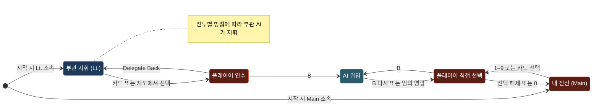
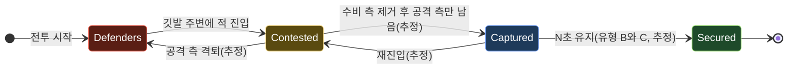
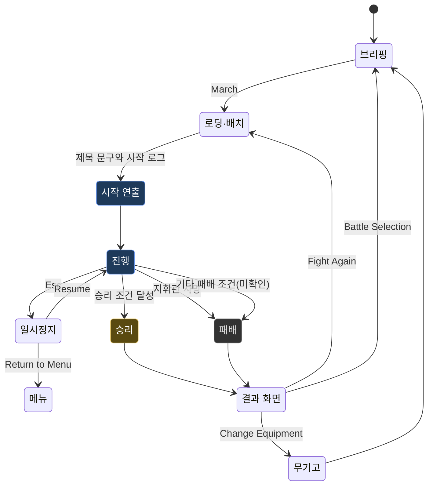

# 03. 게임 시스템

이 문서는 원본의 규칙을 정리한다. 수치는 근거에 있는 값만 쓰고, 근거에서 추론한 내용은 **추정**, 근거가 없는 내용은 **미확인**으로 표시한다. 내부 공식(피해 계산식, 사기 수치, 이동 속도 등)은 에셋이 암호화되어 있어 하나도 확인하지 못했다.

---

## 1. 지휘관 전투

> 근거: `docs/raw/codex.json`(weapons), `docs/raw/keybindings.txt`, `research/index.html`(#help, #skills), `research/g-07-battle-start.png`, `research/original-battle.png`, `docs/raw/briefings.json`

### 1.1 행동 목록

| 행동 | 기본 입력 | 확인된 내용 |
|---|---|---|
| 이동 | W/A/S/D | 8방향 이동으로 추정 |
| 질주 | Shift | 키 설정 `Sprint`. 영웅 패널의 파란 보조 게이지가 줄어드는 것이 관찰됨(g-14) → 스태미나 소모로 추정 |
| 조준 | 마우스 | "Mouse Aim / Attack". 커서는 `crosshair` |
| 연속 공격 Combo | 좌클릭 | 도움말: 3단 연속 베기, 3타째 띄워 날림 |
| 기 모으기 Charge Up / Heavy Attack | 우클릭(누르기) | 도움말: 누르는 시간이 길수록 강함 |
| 스킬 1 (Dash) | Q | 무기 유형별 |
| 스킬 2 (Arc) | E | 무기 유형별 |
| 스킬 3 (Area) | R | 무기 유형별 |
| 스킬 4 (Special) | Y | 무기 유형별 |
| 무쌍 필살기 Musou Ultimate | T (터치: Musou 버튼) | 게이지가 가득 찼을 때만 |
| 회피 Dodge | Space | 도움말: 무적 |

스킬 칸에는 쿨다운이 아래에서 위로 어둡게 표시된다(`.sk.cool`, CSS 변수 `--cd`). 각 스킬의 쿨다운 시간, 피해량, 범위는 미확인이다.

### 1.2 무기 유형과 스킬

장비는 능력치를 주지 않는다. 교범 문구: "Equipment provides no stat bonus. Weapon type sets your moves; the battle determines your strength."(장비는 능력치 보너스가 없다. 무기 유형이 기술을 정하고, 전투가 강함을 정한다.)

| 무기 유형 | Q | E | R | Y |
|---|---|---|---|---|
| 검과 방패 Sword & Shield | Lunging Cut 돌진 베기: 앞으로 돌진하며 적을 베고 지나감 | Shield Bash 방패 강타: 주변 적을 방패로 침 | Riposte 반격: 지휘관 주위로 반격 | Shield Wall 방패벽: 방패를 세워 정면 공격에 버팀 |
| 대검 Greatsword | Advancing Cleave 전진 내려베기: 한 걸음 나가며 강하게 벰 | Wide Cleave 광역 베기: 넓은 호로 휩씀 | Whirlwind 회오리 베기: 회전하며 주변 적을 벰 | Sundering Blow 파쇄 일격: 방어를 깨는 강타 |
| 장병기 Polearm | Piercing Thrust 관통 찌르기: 앞의 적을 꿰뚫음 | Sweeping Strike 휩쓸기: 앞줄을 쓸어냄 | Breakout 돌파: 지휘관 주위 공간을 확보 | Brace 버티기: 정면으로 다가오는 적을 맞받도록 무기를 세움 |
| 활/쇠뇌 Bow / Crossbow | Aimed Shot 조준 사격: 강한 조준 사격 | Step Shot 이동 사격: 자리를 옮기며 쏨 | Piercing Shot 관통 사격: 일직선 관통 | Quick Reload 빠른 장전: 다음 사격을 빠르게 준비 |
| 법구 Focus | Fireball 화염구: 적진에 불을 던짐 | Healing Light 치유의 빛: 주변 아군 회복 | Thunder 낙뢰: 번개로 공격 | Protective Ward 수호 결계: 자신과 주변 아군 보호 |

**HUD 실측 스킬명이 교범과 다르다.** 헤이스팅스에서 무기 `Sacred Cavalry Lance`(장병기로 추정)를 든 상태의 HUD는 `Q Breaking Thrust / E Sweeping Strike / R Breakout Spin / Y Braced Counter / T Repeated Thrusts`였다. 교범 장병기(`Piercing Thrust / Sweeping Strike / Breakout / Brace`)와 E만 같고 나머지는 이름이 다르다. 교범은 유형 대표 설명이고 HUD는 개별 무기 기술명일 가능성이 있다(추정). 영웅 전투 거록에서는 T가 `Army Breaker`였다. 영웅 역할(항우)이 무쌍을 바꿨을 가능성이 있다(추정).

무쌍 필살기의 실제 효과(범위, 지속, 피해)는 관찰하지 못했다(미확인). 도움말은 "무기마다 다름"이라고만 한다.

### 1.3 무쌍 게이지 규칙

| 규칙 | 근거 문구 |
|---|---|
| 게이지가 가득 차면 T 또는 Musou 버튼 | "Press T or tap Musou when the gauge is full." |
| 밀집한 적을 맞힐수록 효율적으로 참 | "Hitting dense enemy ranks builds it efficiently" |
| 빗나가면 0 | "misses add nothing" |
| 한 스킬 안에서 같은 적을 여러 번 맞혀도 1회 | "repeat hits on the same enemy within one skill count once" (영웅 브리핑) |
| 밀집 대형에 스킬 2~3바퀴로 가득 참 | "Two to three full skill rotations into a dense enemy formation can fill Musou." (영웅 브리핑) |
| 가득 차면 게이지가 밝게 깜빡이고 T 칸이 빛남 | CSS `#mu.full`(0.5초 주기 glow), `#sk-t.ready` |

게이지 최대값, 타격당 증가량, 시간에 따른 감소 여부는 미확인이다.

### 1.4 전투 유형별 지휘관 성능

| 항목 | 전술 전투(01–10) | 영웅 전투(11–20) |
|---|---|---|
| 브리핑 문구 | "Your commander is vulnerable and deals 40% of baseline damage. Stay alive and win through troops and terrain." | "Commander: 10,000 HP and 60% damage reduction, accompanied by a small elite guard. Health recovers out of combat." |
| HP | 900 (헤이스팅스 실측, 다른 전술 전투는 미확인) | 10,000 |
| 피해 | 기준 피해의 40% | 기준 피해 대비 배율 미확인 |
| 피해 감소 | 미확인 | 60% |
| 체력 회복 | 미확인(언급 없음) | 비전투 시 회복. 막북 전술: "A short disengagement allows health recovery."(잠깐 교전에서 빠지면 회복) |
| 호위 | 없음 | 소수 정예 호위("small elite guard") — 편성표의 아군 부대가 호위로 추정 |
| 영웅 능력 | 없음 | `Hero's Role` 특성(전투별 이름만 확인, 효과 미확인) |

- "기준 피해(baseline damage)"의 정의는 미확인이다.
- 장비가 능력치를 주지 않으므로, 지휘관 HP·피해·방어는 전투 규칙이 정한다("The battle determines health, damage, and defense.").
- 헤이스팅스 실측: 지휘관이 홀로 노르만 전열에 돌격 → 0:37에 HP 900/900 표시 → 0:45 전사. 집중 공격을 받으면 수 초 안에 죽는다.

---

## 2. 군대 시스템

> 근거: `docs/raw/briefings.json`, `docs/raw/battle-ui.json`, `research/g-07-battle-start.png`, `research/g-11-tacmap.png`, `research/original-battle.png`, `research/index.html`

### 2.1 부대(company)와 유닛(unit)

- 브리핑 편성은 **부대** 단위다: `부대명〔병종〕병력`. 예: `Saxon Spearmen〔Halberd Guard〕2,400`.
- 전투에서는 부대가 여러 **유닛**으로 나뉘어 카드 한 장씩을 갖는다. 헤이스팅스 English Army 6,000명은 `Total 11 Unit`으로 표시됐다.
- **분할 규칙(추정: 유닛당 최대 600명)**. 600명씩 자르고 나머지를 별도 유닛으로 만들면 실측과 맞는다.

| 부대 | 병력 | 600명 분할 | 유닛 수 |
|---|---|---|---|
| Saxon Spearmen | 2,400 | 600×4 | 4 |
| Saxon Shield Guard | 1,600 | 600, 600, 400 | 3 |
| Royal Axemen | 1,200 | 600×2 | 2 |
| English Archers | 800 | 600, 200 | 2 |
| 합계 | 6,000 | | **11** (실측 `Total 11 Unit`과 일치) |

  - 전술 지도에서 아군 `400`, `200` 태그와 적 `200`, `400` 태그가 실제로 보인다(g-11).
  - 영웅 거록 Chu Army 600명(240/160/120/80)은 모두 600 이하라 `Total 4 Unit`이 된다(실측 일치).
- 유닛 카드 첫 쪽 6장 실측(헤이스팅스): `1 · Main Saxon Spearmen`, `2 · Main Saxon Spearmen`, `3 · Lt. 1 Saxon Spearmen`, `4 · Lt. 1 Saxon Spearmen`, `5 · Main Saxon Shield Guard`, `6 · Lt. 1 Saxon Shield Guard`. 2쪽 5장의 구성은 미확인이다.
- 유닛 상태 문구 실측: `Pikes Braced`(창 버팀), `Advancing`(전진 중), `Hold`(고수). 그 밖의 상태 문구는 미확인이다.
- 병력은 실시간으로 줄어 카드에 반영된다(0:37 실측: 559, 600, 600, 592, 584, 599명).

### 2.2 전선(front)과 부관(lieutenant)

전술 전투는 전장을 2~3개 **전선**으로 나눈다. 플레이어가 한 전선을, 부관 1~2명이 나머지를 맡는다. 브리핑 공통 문구:

> "With no unit selected, orders affect your front. Select a unit card or a unit on the tactical map to take over another front, then return it to the lieutenant."
> (부대를 선택하지 않으면 명령은 내 전선에 적용된다. 유닛 카드나 전술 지도의 부대를 선택하면 다른 전선을 인수하고, 이후 부관에게 돌려준다.)

| 개념 | 규칙 | 근거 |
|---|---|---|
| 내 전선 (Main) | 카드에 `Main`. 아무것도 선택하지 않은 상태의 명령 대상 | 브리핑, 카드 |
| 부관 전선 (Lt. N) | 카드에 `Lt. 1`, `Lt. 2`. 부관 AI가 지휘. 전투별로 행동 방침이 정해져 있음(예: "남쪽 날개가 무너지면 부관은 기병을 쫓아 내려가지 않고 반대 사면으로 물러난다") | 브리핑 |
| 인수 (take over) | 부관 전선의 카드나 지도 위 부대를 선택하면 플레이어가 직접 지휘 | 브리핑 |
| 반환 (Delegate Back) | 도구줄 `Delegate Back`으로 부관에게 돌려줌. 인수한 부대가 없으면 버튼이 흐림 | g-07(흐림 상태) |
| 전선 선택 (Select Front, `` ` ``) | 내 전선 전체를 선택. HTML 원형 이름은 `全軍`(전군), 버튼 `選取全軍` | 키 설정, index.html |
| 내 전선 복귀 (0) | 도움말: "`` ` ``／0 回到本路（可接管副將）" → 내 전선으로 돌아감 | index.html |
| AI 배지 | 카드 우상단 `AI`. 실측 시 모든 카드에 붙어 있었음 → 플레이어가 직접 명령하지 않은 유닛은 AI 표시로 추정 | g-07 |
| AI 위임 (B) | "Delegate to AI (press again to retake)". 도움말: 아무 명령이나 내려도 회수됨 | 키 설정, index.html |

전투별 전선 배치는 04 문서 7장.

영웅 전투는 브리핑에 전선 문구가 없고, 거록 실측 카드는 모두 `1~4 · Main` + `AI`였다. 부관 없이 전군이 내 전선이다(추정).

플레이어가 부대를 고르고, 인수하고, 반환하는 상태 전이는 아래와 같다. 부대는 처음에 내 전선(Main) 또는 부관 전선(Lt.)에 속한다. 부관 전선 부대를 선택하면 플레이어 직접 지휘로 넘어오고, `Delegate Back`으로 돌려준다. 어느 쪽이든 B를 누르면 AI 위임 상태가 되고, 다시 B를 누르거나 다른 명령을 내리면 회수된다.

> 인수 상태에서 B를 누른 뒤 회수했을 때 부대가 플레이어 쪽으로 오는지 부관 쪽으로 가는지는 미확인이다. 그림은 플레이어 쪽으로 가정했다.

### 2.3 선택

| 방법 | 동작 | 근거 |
|---|---|---|
| 숫자 1–9 | 해당 번호 유닛으로 전환. Shift를 누르면 추가 선택 | 키 설정 고정 키 |
| 0 | 내 전선(Army)으로 복귀 | 키 설정 고정 키 |
| `` ` `` | 전선 선택 | 키 설정 |
| 카드 클릭 | 해당 유닛 선택(`.sel` 강조) | CSS |
| 전술 지도 좌클릭 / Shift+좌클릭 | 선택 / 추가 선택 | 도움말 |
| ◀ ▶ | 카드 쪽 넘김 | g-07 |

10번 이후 유닛(헤이스팅스 11번)을 숫자 키로 고르는 방법은 미확인이다.

### 2.4 전투 속도

도구줄 `Speed 1×`(원형 `戰速 1×`). 선택 가능한 배속 값은 미확인이다.

### 2.5 사기와 궤주

- 유닛 카드에 금색 두 번째 막대가 있다(CSS `.card .mo`). 사기로 추정한다.
- 카드 상태 `.rout`(궤주)과 `.dead`(전멸)가 있다.
- 브리핑 문구: "Defeating an enemy commander shakes nearby morale."(적 지휘관을 쓰러뜨리면 주변 사기가 흔들린다, 팽성)
- 도움말의 옛 R 스킬 설명에 "友軍士氣回升、攻擊提升、潰兵重整"(아군 사기 회복, 공격 상승, 궤주 병 재집결)이 있어 사기·궤주·재집결 개념이 있다.
- 사기 수치, 궤주 기준, 재집결 조건은 미확인이다.

---

## 3. 명령과 진형

> 근거: `docs/raw/keybindings.txt`, `research/g-10-command.png`, `research/index.html`, `docs/raw/briefings.json`

### 3.1 명령

| 명령 | 키 | 패널 표기 | 동작 | 근거 |
|---|---|---|---|---|
| 전방 정렬 Form Ahead | C | `C Form Ahead` | 지휘관 앞으로 진형을 갖춤(원형 `列陣向前`, data-c `follow`) → 지휘관을 따라 앞에 정렬로 추정. 하서 전술 "Use Form Up to keep them together between the camps."(진영 사이에서 호위를 모아둘 때 사용) | 패널, index.html, 브리핑 16 |
| 커서 공격 Attack at Cursor | V | `V Attack` | 커서 위 적 부대 공격. 지면을 가리키면 진형을 갖춰 그 위치로 이동 | index.html title |
| 돌격 Charge | Z | `Z Charge` | 돌격(원형 `衝鋒`). 대상 지정 방식 미확인 | 패널 |
| 커서 고수 Hold at Cursor | X | `X Hold` | 커서 위치에 진형을 갖추고 고수. 창 계열은 고수 상태에서 버팀(brace). 헤이스팅스 전술 "Use Hold (X) to brace; moving or pursuing lowers their spears."(X로 버팀, 이동하거나 추격하면 창을 내린다) | index.html, 브리핑 01 |
| AI 위임 Delegate to AI | B | `B AI Command` | AI에 지휘를 맡김. 다시 누르면 회수, 다른 명령을 내려도 회수 | 키 설정, 도움말 |
| 전선 선택 Select Front | `` ` `` | 도구줄 `Select Front` | 2.2 참조 | |
| 현 위치 고수 | (버튼) | 도구줄 `Hold現位` | 원형 `固守現位`. 커서가 아닌 현재 위치에서 고수로 추정 | index.html |
| 전술 지도 명령 | 우클릭 | — | 선택 부대에 명령. 우클릭 대상(적/지면)에 따라 공격/이동으로 추정 | 도움말 |

명령 대상은 "선택한 유닛 → 없으면 내 전선"이다. 실측 패널 머리 `Command: Main · North Ridge`가 현재 대상을 보여준다.

### 3.2 진형

| 진형 | 키 | 원형 이름 | 효과(근거) |
|---|---|---|---|
| 방진 Block | F | 方陣 | 기본 진형(실측 `陣形: Block`) |
| 원진 Circle | G | 圓陣 | 효과 문구 없음(미확인) |
| 쐐기진 Wedge | H | 楔型陣 | 효과 문구 없음(미확인) |
| 장사진 Snake | [ | 長蛇陣 | 효과 문구 없음(미확인) |
| 공심방진 Hollow Square | ] | 空心方陣 | 철벽 근위대 조언 "guard the outside of a hollow square"(공심방진의 바깥을 지킴) |

진형별 수치 효과(방어, 이동 속도, 측면 보호)는 근거에 없다(미확인). 병종 문구의 "settled defensive formations resist knockback and launch"(자리 잡은 방어 진형은 밀쳐내기와 띄우기에 저항)로 보아 진형이 안정된 상태와 이동 중 상태를 구분한다(추정).

---

## 4. 병종 상성과 전장 규칙

> 근거: `docs/raw/codex.json`(troops, terrain), `docs/raw/briefings.json`(지형 문구, 전술)

병종별 능력치 표는 04 문서 2장. 여기서는 병종 문구와 브리핑에 나온 **상호작용 규칙**만 묶는다.

### 4.1 근접·버팀·기병

| 규칙 | 근거 문구 | 관련 병종 |
|---|---|---|
| 창 계열은 **고수 중 버팀**으로 정면 기병 돌격을 멈춤 | "Brace while holding position to stop frontal cavalry charges." | 창병, 미늘창 근위대("Long braced sweeps stop frontal cavalry and infantry"), 용아 장창대("six-step braced reach stop frontal cavalry") |
| 버팀은 이동·추격하면 풀림 | "moving or pursuing lowers their spears"; 창병 약점 "Close attacks during movement" | 창병 계열 |
| 버팀이 자리 잡을 시간이 필요 | "Order Hold and let the formation settle before the cavalry arrives." | 창병 |
| 측면·후방에 취약 | 창병, 미늘창, 용아 약점: flanks and rear | 창 계열 |
| 돌격 기병은 도움닫기 중 창을 내리고 적진을 관통 | "Lower lances during the run-up and charge through enemy lines." | 돌격 기병 |
| 기병의 **띄워 날리기(launch)**: 피해 대상 수 한도에 도달한 뒤에도 적을 띄울 수 있음 | "Riders can still launch enemies after reaching their damage target limit." | 돌격 기병 |
| 중장 돌격 기병은 기병 1명당 돌격 1회에 최대 4명에게 피해, 돌격 속도를 유지하면 띄우기 횟수 제한 없음 | "damage up to four targets per rider per charge. Maintaining charge speed can still launch further enemies without a launch count cap." | 중장 돌격 기병 |
| 돌격 후 재집결 필요 | "Charges require regrouping."; "pull clear to regroup" | 돌격 기병, 중장 돌격 기병 |
| 돌격 기병은 도움닫기 거리가 필요 | "Leave run-up distance"; 막북 "Leave room to build charge speed." | 기병 |
| 기병은 정면의 버틴 창·온전한 방패에 약함 | 돌격 기병 약점 | |
| 습격 기병은 이동하며 베고 흩어진 병사를 밀쳐냄, 오래 서서 싸우면 불리 | "Slash while moving and shove scattered troops aside." / "prolonged stationary melee" | 습격 기병, 혈랑 기병 |
| 다중 타격 | 파진 친위대 "Three-hit attacks, each sweeping up to three enemies", 철부 노병 "Three heavy cuts, each hitting up to two enemies", 돌격 보병 "Broad swings hit enemies in front" | |
| 방어 후 반격 | 어림 친위대 "Block frontal attacks and counterattack." | |
| 안정 진형은 밀쳐내기·띄우기·제어 효과에 저항 | 철벽 근위대, 어림 친위대 | |

### 4.2 방패와 투사체

| 규칙 | 근거 문구 |
|---|---|
| 정면 방패벽은 **방패 내구(shield capacity)** 가 바닥날 때까지 공격을 막음 | 방패 보병 "A frontal shield wall blocks attacks until its shield capacity is exhausted." |
| 방패는 화살을 흡수 | 헤이스팅스 전술 "Shields absorb arrows."; 합비 "use … shields to cover the withdrawal from arrows" |
| 방패 보병·철벽 근위대의 약점은 측면과 **파순(방패 깨는) 쇠뇌** | 약점 문구 |
| 쇠뇌는 관통력이 강하고 재장전이 느림 | 쇠뇌병 "Powerful penetrating bolts, with a slower reload." |
| 중쇠뇌 근위대: 2명 관통, 방패에 추가 피해 | "Bolts penetrate two enemies and inflict extra shield damage." |
| 파순 쇠뇌대: 3명 관통, 방패에 일반 화살의 2배 넘는 피해 | "Bolts penetrate three enemies and deal more than twice normal arrow damage to shields." |
| 관통 장궁대: 적 방어를 평소의 45%로 취급 | "Long-range heavy arrows treat enemy armor as 45% of its normal value." |
| 장궁병: 곡사로 낮은 비탈을 넘김, 온전한 방패벽에 약함 | "Long-range arcing fire can clear low slopes." / 약점 "intact shield walls" |
| 투사체 부대는 근접전과 사격 간격에 약함 | 장궁병, 쇠뇌병 약점 |

방패 내구 수치, 관통 시 피해 감쇠, 사격 간격(초)은 미확인이다.

### 4.3 지형

| 규칙 | 근거 문구 |
|---|---|
| 고지는 투사체 사거리를 늘림 | 지형 "High ground extends missile range." |
| 능선은 직사를 막고, 화살은 낮은 마루를 넘어감 | "Ridges block direct fire, while arrows can pass over lower crests." (20개 브리핑 공통) |
| 오르막 이동은 느리고, 완만한 내리막은 돌격을 도움 | "Uphill movement is slower; gentle descents help charges." (20개 브리핑 공통) |
| 절벽은 오를 수 없음. 길과 트인 접근로를 이용 | "Cliffs cannot be climbed; use roads and open approaches." |
| 깊은 물은 통과 불가 | "Deep water is impassable." |
| 교두보는 좁음. 출구를 창과 방패로 막고 투사체로 지원 | "Bridgeheads are narrow: hold their exits with pikes and shields, supported by missiles." |
| 숲과 진흙은 진형을 느리게 하고 기병 도움닫기를 방해 | "Woods and mud slow formations and disrupt cavalry run-ups. Launch charges along open ground." |
| 산길에서는 돌격 유지가 어려움 | 정군산 "Mountain paths make sustained charges difficult." |
| 깃발 점령은 주변 적을 치워야 함 | "Clear nearby enemies to capture flags." |
| 일부 전투는 확보 유지, 동료 구출, 출구 귀환이 필요 | "Some battles require a secure hold, a rescued companion, or a return to the exit." |

사거리 증가량, 속도 배율은 미확인이다.

---

## 5. 승리 조건과 목표

> 근거: `docs/raw/briefings.json`(Victory Conditions), `research/g-07-battle-start.png`, `research/original-battle.png`

### 5.1 목표 유형 분류 (20개 전투)

20개 승리 조건을 문구 구조로 분류하면 일곱 가지다.

| 유형 | 규칙 | 전투 | 수치 |
|---|---|---|---|
| A. 깃발 보유 시간 **또는** 궤주 | 깃발 중 최소 하나를 N분 보유하거나 적을 궤주시킴 | 01 헤이스팅스(능선 깃발, 9분), 02 스털링(동쪽 다리 깃발, 9분), 04 아쟁쿠르(반대 사면 깃발, 10분), 06 마릉(매복 깃발, 9분), 09 배넉번(숲 깃발, 10분) | 9분 / 10분 |
| B. 여러 깃발 **동시** 보유 N초 | 지정 깃발을 모두 점령해 동시에 N초 유지 | 03 정군산(2개, 22초), 07 정형(2개, 18초), 08 관도(2개, 20초), 18 백포(3개, 15초) | 15–22초 |
| C. 각 깃발 **개별** 확보 15초 | 지정 진영마다 15초씩 확보 | 11 거록(보급 진영 2 + 본영 1, 각 15초) | 15초 |
| D. 적 유효 병력 20% 미만 | 적 유효 병력을 시작 대비 20% 미만으로 | 05 칸나에(양 진영 공통), 10 이소스, 12 팽성(궤주 + 20% 미만), 17 막북, 20 언성 | 20% |
| E. 적 지휘관 격파 + 30% 궤주 | 적 지휘관을 쓰러뜨리고(또는 사로잡고) 적의 30% 이상 궤주 | 14 곤양(Xin 지휘관 격파), 19 호뢰(두건덕 제압·생포) | 30% |
| F. 호위 | 보호 대상을 받아 지정 구역까지 호위 | 15 장판(감부인과 어린 후계자 2명 → 서쪽 피난 구역) | — |
| G. 점령 후 귀환 | 깃발을 점령한 뒤 지휘관이 출구로 돌아감 | 13 합비(전방·본영 깃발 → 성문), 16 하서(두 진영 깃발 → 서쪽 출발 지역) | — |
| 공통(전술) | **지휘관 사망 = 패배** | 01–10 브리핑 전부 "Your commander's death means defeat." | — |

- "유효 병력(effective strength)"의 정의는 미확인이다. 궤주한 병력을 제외한 수로 추정한다.
- 유형 A의 "또는 궤주(rout the …)"에서 궤주 판정 기준(비율)은 미확인이다.
- 유형 E에서 "subdue and capture"(제압·생포)가 일반 격파와 다른 처리인지는 미확인이다.
- 영웅 전투 브리핑에는 지휘관 사망 패배 문구가 없다. 영웅 전투에서 지휘관 사망 시 패배인지는 미확인이다.
- 시간 초과 시 처리: 유형 A는 카운트다운이 0이 되면 승리로 추정한다(보유 조건 충족 시). 다른 유형의 제한 시간 초과 결과(패배 여부)는 미확인이다.

### 5.2 목표 띠와 타이머

| 항목 | 내용 | 근거 |
|---|---|---|
| 경과 시간 | 상단 중앙 `00:04`처럼 위로 셈. 일시정지 중 멈춤 | g-07, g-08 |
| 목표 띠(유형 A) | `Flags 깃발명: 상태 깃발명: 상태 ｜ 남은시간` | g-07 |
| 목표 띠(유형 C) | `Capture Camps 0 / 3 ｜ 11:59` | original-battle |
| 카운트다운 실측(헤이스팅스) | 경과 00:04 → 8:54, 00:12 → 8:47, 00:13 → 8:46, 00:18 → 8:41, 00:19 → 8:39, 00:31 → 8:29, 00:37 → 8:22 | g-07~g-14 |
| 시작 로그 | `00:00 승리 조건 문장` | g-07, original-battle |

- 헤이스팅스 카운트다운은 대략 "9:00 − 경과 시간"이다. 캡처 시점 차이로 1~3초 오차가 있다. 깃발이 `Contested`로 바뀐 0:37에도 계속 줄었으므로, 쟁탈 중에도 카운트다운은 멈추지 않았다(관찰 범위 안에서). 깃발을 잃었을 때 카운트다운이 멈추는지, 초기화되는지는 미확인이다.
- 거록 `11:59`는 시작 시점 값이다. 제한 시간 12분으로 추정한다.
- 다른 전투의 제한 시간은 미확인이다.

### 5.3 깃발 상태

관찰된 깃발 상태는 `Defenders`(수비 측 보유)와 `Contested`(쟁탈 중) 두 가지다. 지형 문구 "Clear nearby enemies to capture flags."(주변 적을 치워야 점령)와 유형 B·C의 "점령 후 N초 확보"로 보아, 깃발은 아래처럼 전이한다고 추정한다. `Captured`(공격 측 점령) 같은 상태 이름은 화면에서 보지 못했다.

- 실측: 헤이스팅스 0:04~0:31 두 깃발 모두 `Defenders` → 0:37 둘 다 `Contested`.
- 점령 진행 게이지 표시 여부, 점령에 걸리는 시간, 깃발 반경은 미확인이다. 숨겨진 `#siegehud`의 `主堡奪取`(본성 탈취) 게이지가 비슷한 용도일 수 있다(추정).

### 5.4 전투 생명주기

전투는 브리핑에서 출진하면 시작 연출(제목 문구, 시작 로그)을 거쳐 진행 상태가 된다. 진행 중에는 일시정지로 멈출 수 있다. 승리 조건을 채우면 승리, 지휘관이 죽으면 패배 결과로 간다. 결과 화면에서 다시 싸우기, 전투 선택, 장비 변경으로 나간다.

---

## 6. 결과, 업적, 명예 점수

> 근거: `research/g-15-state.png`, `research/g-03-achievements.png`, `docs/raw/achievements.txt`

### 6.1 결과 화면 통계

| 항목 | 실측(헤이스팅스 패배) |
|---|---|
| Battle Time | 0:45 |
| Personal Kills | 0 |
| Enemy Losses | 446 |
| Allied Survivors | 5,447 |
| 사유 | "Your commander has fallen. The army has lost its leader." |

### 6.2 업적

- 총 **100개**(`0 / 100`) = 20개 전투 × 전투당 5개("Five Battle Achievements").
- 업적마다 **명예 점수(Honor Points)** 가 있다. 헤이스팅스 5개: 15 / 25 / 25 / 35 / 40점(합 140점).
- 헤이스팅스 업적 조건 패턴(04 문서 8장):
  1. 추천 진영으로 승리
  2. 추천 진영으로 승리 + 특정 병종 계열(창 부대)로 적 30명 이상 격파
  3. 추천 진영으로 승리 + 특정 병종 계열(활 부대)로 적 30명 이상 격파
  4. 추천 진영으로 승리 + 시작 병력의 45% 이상 생존
  5. 추천 진영으로 승리 + 제한 시간(8분 6초) 안에 승리
- 모든 조건에 "as the recommended side"(추천 진영으로)가 붙는다. 비추천 진영 승리는 업적을 주지 않는 것으로 추정한다.
- 다른 19개 전투의 업적 이름, 조건, 점수는 미확인이다(근거 파일에 헤이스팅스만 있음, `codex.json`의 `achievements` 배열은 비어 있음).
- 명예 점수의 용도(해금, 순위)는 미확인이다. 무기고 안내 "No currency or unlock is required."로 보아 장비 해금에는 쓰지 않는다.

### 6.3 승리 기록

전투 선택 화면에 `Victories 0 / 20`이 있다. 전투별 승리 여부를 저장한다(추정). 승리한 전투의 목록 표시 방식은 미확인이다.

---

## 7. 저장 (persistence)

| 대상 | 저장 | 근거 |
|---|---|---|
| 언어 | localStorage `song-of-ashes.language.v1` (`auto` / `en` / `zh-Hant`로 추정) | index.html |
| 키 바인딩 | 브라우저 저장. 키 이름 미확인 | 키 설정 안내문 |
| 지휘관 이름·부대 이름·문장·초상 | 브라우저 저장(재방문 시 메뉴 명패 유지). 키 이름 미확인 | g-01 |
| 외형 장비 | "Your appearance carries across battles." 키 이름 미확인 | g-06 |
| 승리 기록, 업적 진행도, 명예 점수 | 저장으로 추정. 키 이름 미확인 | g-03, briefings |
| 설정(인터페이스 모드, 효과, 피해 숫자, 화면 흔들림) | 저장 여부 미확인 | |
| 전투 중간 저장 | 없음으로 추정(UI에 저장·불러오기 없음) | |
