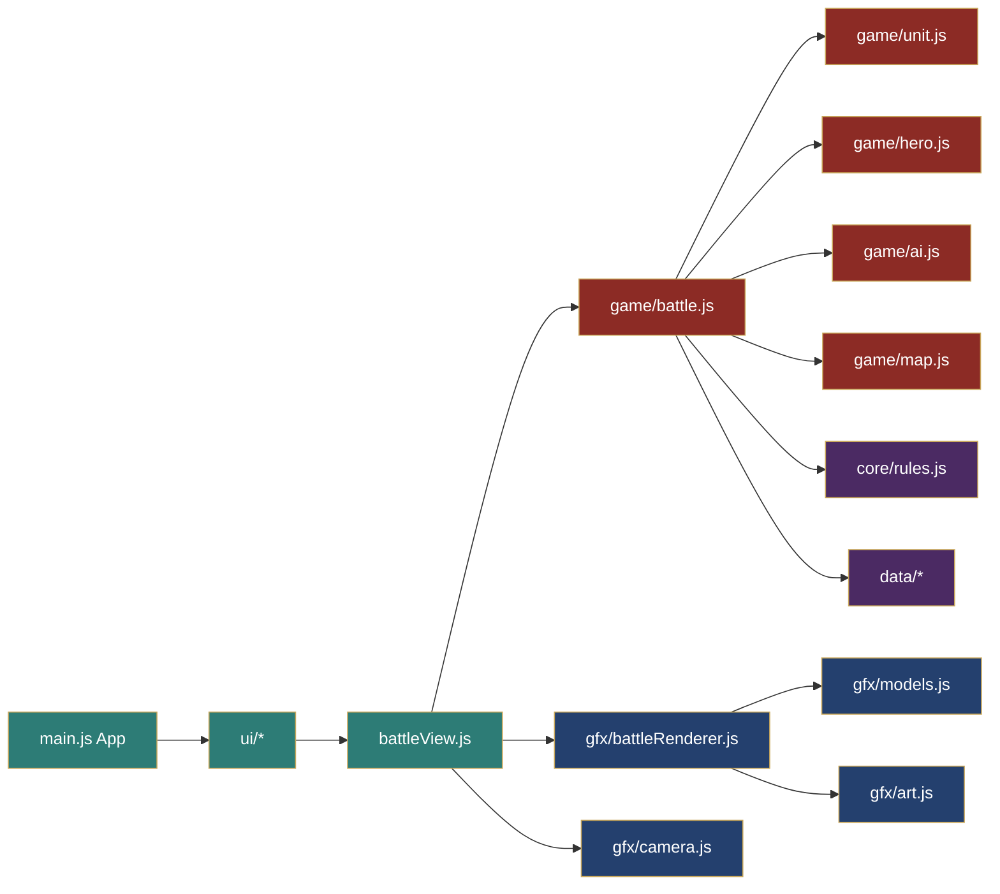
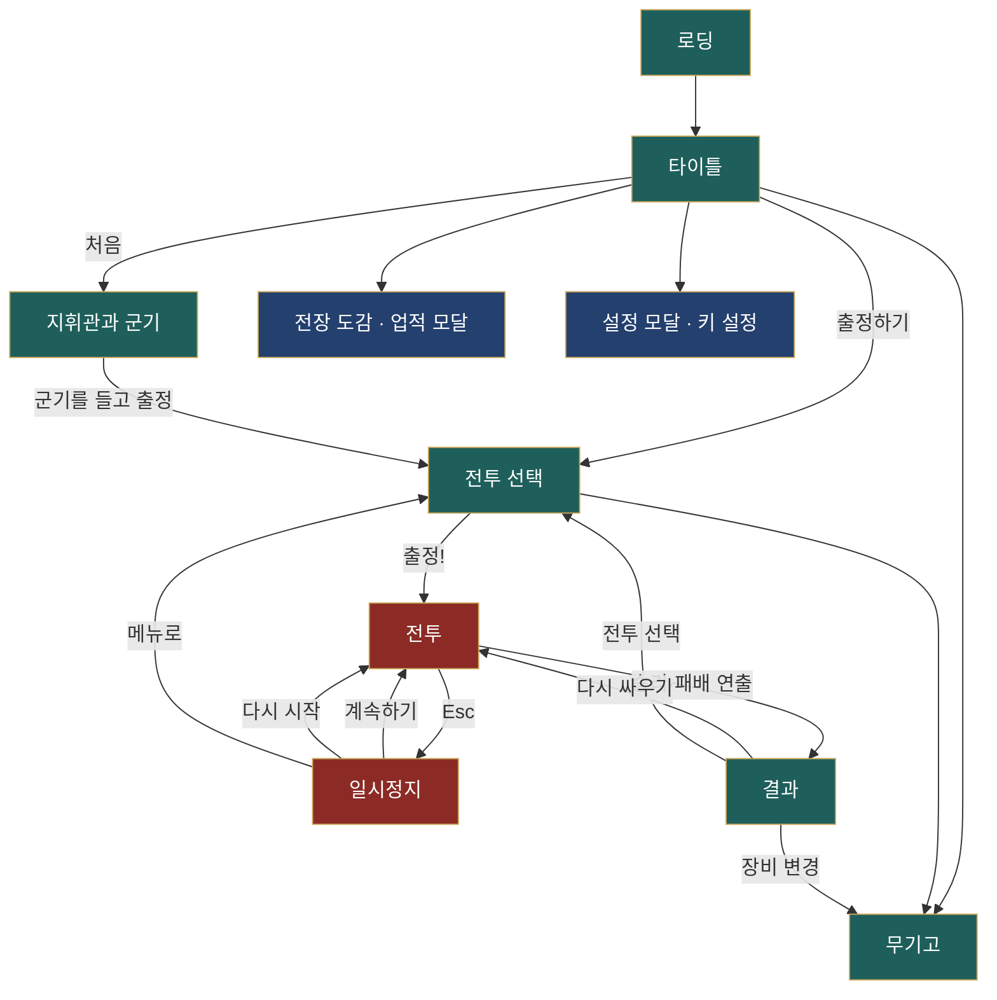
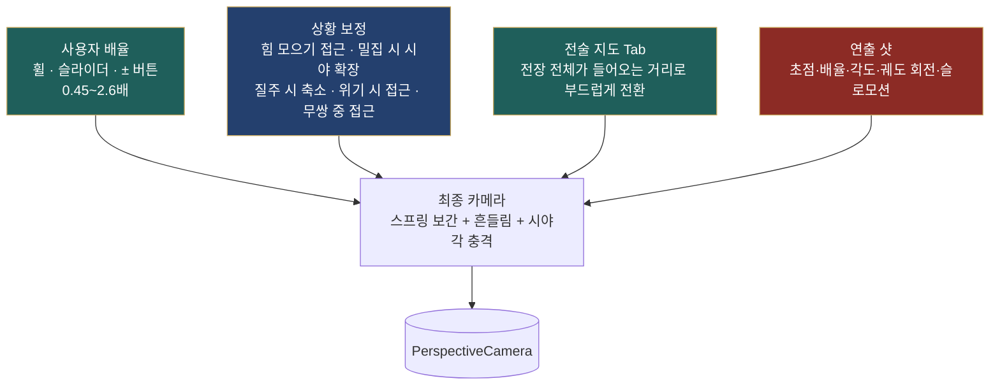

# 06. 재구현 설계 — 「영웅의 전장」 (three.js)

원본 「Song of Ashes｜灰燼之歌」의 **게임 요소는 그대로** 두고, **리소스·화면 구성은 새로** 만들었으며 **모든 메뉴는 한국어**다. 이 문서는 구현이 무엇을 어디에서 하는지, 원본 분석(01~05)의 어느 항목을 어떻게 옮겼는지, 원본에서 확인하지 못한 부분을 어떤 규칙으로 정했는지를 기록한다. 이후 개발할 때 이 문서와 소스 주석을 함께 보면 된다.

- 실행: `npm install` → `npm run dev` (Vite) → 브라우저에서 `http://localhost:5173`
- 테스트: `npm test` (규칙·저장·헤드리스 전투 15건)
- 균형 점검: `npm run sim -- [전투 id...]` (지휘관 봇 포함 헤드리스 전투)
- 빌드: `npm run build` → `dist/`

---

## 1. 원본 요소 → 재구현 대응표

원본에서 관찰한 핵심 요소와 재구현 위치다. "동일"은 규칙·수치를 그대로 옮긴 것이고, "재설계"는 원본 정보가 없거나 3D로 바꾸면서 새로 정한 것이다.

| 원본 요소 (근거 문서) | 재구현 | 위치 | 구분 |
|---|---|---|---|
| 전투 20개(전술 역사 10 · 영웅 무쌍 10), 연대·양군 편성·지휘관·전선·지형·승리 조건·역사 (04) | 같은 20개 전투, 편성 수치 그대로, 역사 서술은 한국어 요약 | `src/data/battles.js` | 동일 |
| 병종 19종: 병사당 체력·피해·피해 감소·사거리·능력·요령·약점 (04 §1) | 수치 그대로 + 시뮬레이션 분류(cls) | `src/data/troops.js` | 동일 |
| 무기 계열 5종과 Q/E/R/Y·무쌍 (04 §2) | 같은 5계열·4기술·무쌍, 판정 방식을 새로 정의 | `src/data/weapons.js`, `src/game/hero.js` | 동일+재설계 |
| 지휘관: 전술 체력 900·기준 피해 40% / 영웅 체력 10,000·피해 감소 60%·비전투 회복 (03) | 그대로 | `Hero` 생성자 | 동일 |
| 무쌍: 밀집한 적 적중으로 충전, 빗나가면 0, 한 기술 내 같은 적 중복은 1회 (03) | 고유 적중 수 기반 충전, `dedupe` 키로 중복 제거 | `Hero.gainMusou`, `Battle.heroStrike` | 동일 |
| 중대·전선·부장, 카드 선택으로 다른 전선 인수, 「Delegate Back」 (03) | 부대(Unit)·전선(front)·부장 AI, 카드/전술 지도 선택 시 본진으로 인수, 「부장에게 반환」 | `src/game/battle.js`, `src/game/ai.js` | 동일 |
| 명령 C/V/Z/X/B, 진형 F/G/H/[/], 전선 선택 `, 1–9·0 (05) | 같은 키·같은 의미 | `Battle.command`, `BattleView.readInput` | 동일 |
| 창 세우기 vs 기병, 방패 내구, 측후방, 관통·갑옷 관통, 고지 사거리, 숲·진흙 감속, 강·다리, 절벽 (03, 04) | 수식화(§4) | `src/core/rules.js`, `Battle.meleeHit/fireVolley` | 재설계(수치) |
| 깃발: 주변 적을 몰아내면 점령, 유지·동시 유지·차례 점령·귀환·호위·적장 (03) | 7가지 목표 유형 | `evaluateObjective`, `Battle.updateFlags` | 동일+재설계 |
| 전투당 업적 5개(헤이스팅스는 원문 그대로), 명예 점수, 훈장 (03, 04) | 헤이스팅스 원문 + 나머지 재설계 | `battles.js` `achievements` | 동일+재설계 |
| 지휘관·군기(이름, 군단명, 분할·문장·기하 문양, 4색, 프리셋, 초상 40=남24·여16) (02, 04) | 같은 구성, 문장·초상은 새로 그림 | `src/ui/menus.js`, `src/gfx/art.js` | 동일+새 리소스 |
| 무기고: 무기·갑옷·투구·망토·탈것·마갑, 능력치 없음, 회전 미리보기 (02) | 같은 구성, 3D 미리보기 | `armoryScreen`, `src/gfx/preview.js` | 동일+새 리소스 |
| 전장 도감(병종/무기와 기술/지형/전투/업적) (02) | 같은 5탭 | `src/ui/codex.js` | 동일 |
| 전투 HUD(병력 막대, 시간, 목표 띠, 이벤트 기록, 지휘관 패널, 기술 칸, 부대 카드, 미니맵, 확대/축소, 명령, 전술 지도) (02) | 모두 존재, 배치·디자인은 새로 | `src/ui/battleView.js` | 재설계(화면) |
| 결과 화면(시간·직접 격파·적 손실·아군 생존, 다시 싸우기·전투 선택·장비 변경) (02) | 같은 정보 + 업적 달성 표시 | `src/ui/result.js` | 동일+보강 |
| 일시정지(계속·키 설정·병종 도감·메뉴로·업적·화면 흔들림·효과·피해 숫자·인터페이스) (02) | 같은 항목 | `BattleView.openPause`, `openSettings` | 동일 |
| 인터페이스 모드 자동/데스크톱/모바일 가로 (05) | 터치 스틱·기술 패드 | `BattleView` `.touch` | 동일(간이) |
| 2D 픽셀 그래픽(WebGL 캔버스) (01) | **three.js 3D 로우폴리**, 모든 모델 절차적 생성 | `src/gfx/*` | 새 리소스 |
| 원본 Zoom 슬라이더(배율 표시) (02) | 휠·슬라이더·± 버튼 + **상황별 자동 확대/축소 연출** | `src/gfx/camera.js` | 확장 |

---

## 2. 아키텍처

시뮬레이션은 three.js·DOM 에 전혀 의존하지 않는 순수 JS다. 그래서 같은 전투를 Node 에서 돌려 테스트·균형 점검을 할 수 있고, 렌더러는 시뮬레이션 상태를 읽기만 한다.

```
src/
├─ main.js              앱 진입·화면 전환(App)·메인 루프
├─ core/   rules.js(순수 규칙) · save.js(저장/키) · audio.js(효과음 합성)
├─ data/   troops.js · weapons.js · battles.js
├─ game/   map.js(지형 격자·A*) · unit.js(부대·대형) · hero.js(지휘관·장수) · ai.js(전선 AI) · battle.js(오케스트레이터)
├─ gfx/    stage.js(공용 렌더러) · models.js(절차적 모델) · art.js(문장·초상·표지) · battleRenderer.js · effects.js · camera.js · menuScene.js · preview.js
└─ ui/     dom.js · styles.css · menus.js · select.js · codex.js · result.js · battleView.js
tests/     rules.test.js · battle.test.js
scripts/   sim-run.mjs(헤드리스 균형 점검)
```

모듈 의존은 한 방향이다. UI → (게임 + 그래픽) → 데이터·규칙.



### 2.1 한 프레임의 흐름

`BattleView.frame(dt)` 가 매 `requestAnimationFrame` 마다 실행된다. 시뮬레이션 시간은 `dt × 배속 × 카메라 슬로모션 배율` 이며 0.04초 단위로 잘라 여러 번 진행한다(큰 dt 에서도 판정이 튀지 않도록).

```
입력 읽기(키·마우스·터치 → 조준점) → 시뮬레이션 n스텝 → 이벤트 처리(효과·소리·카메라 연출·기록)
→ 카메라 갱신 → 렌더러 갱신(인스턴스 행렬) → 렌더 → HUD 갱신 → (종료 시 결과 화면)
```

### 2.2 화면 흐름



---

## 3. 시뮬레이션 모델

### 3.1 좌표·지도

- 단위 m, x 동(+)·서(−), z 남(+)·북(−). 지도 기본 320 × 220 m. 카메라는 남쪽에서 북쪽을 보므로 **화면 위 = 북쪽**이다(W = −z).
- `BattleMap` 은 특징(feature) 목록을 2 m 격자(160 × 110)로 래스터화한다. 지형 종류와 이동 배율은 다음과 같다.

| 지형 | 이동 배율 | 통행 | 비고 |
|---|---|---|---|
| 풀밭 | 1.0 | 가능 | 기준 높이 +1 m |
| 모래 | 0.92 | 가능 | 사막 전투 |
| 진흙 | 0.55 | 가능 | 기병 돌격 불가 |
| 숲 | 0.65 | 가능 | 기병 돌격 불가 |
| 길 | 1.08 | 가능 | |
| 여울 | 0.5 | 가능 | 기병 돌격 불가 |
| 다리 | 1.0 | 가능 | |
| 깊은 물·바다·절벽·목책·가옥 | 0 | **불가** | |

- 높이: 언덕(코사인 감쇠 타원) 합 + 잔잔한 기복, 강은 −2.2 m 로 판다. 물 평면은 −0.55 m 이므로 강바닥과 바다에만 드러난다.
- 경로: 8방향 A*(모서리 끼어들기 금지, 지형 배율을 비용에 반영) 후 시야 기반 단순화. 틱당 탐색 예산 3회, 실패하면 5초간 재탐색하지 않고 벽을 따라 미끄러진다. 목표가 5 m 이상 움직였을 때만 재탐색한다.

### 3.2 부대(중대)와 병사 인형

전투 계산은 **병력 수(troops)** 로 하고, 화면에는 비율(ratio)만큼의 **병사 인형(figure)** 이 대형 자리를 따라 움직인다.

| 구분 | 중대 최대 병력 | 인형 1개 = 병사 수 |
|---|---|---|
| 전술 전투(양측) | 600 (원본 카드와 같은 분할) | 12 |
| 영웅 전투 아군(친위대) | 분할 없음(편성 그대로) | 4 |
| 영웅 전투 적군 | 1,000 | 20 |

- 같은 병종의 중대는 전선 수에 고르게 나눈다(`frontIndexFor`). 전선 안에서는 창·방패 앞줄, 보병 둘째 줄(−16 m), 사격 셋째 줄(−32 m), 기병 양 날개.
- 대형 자리: 방진(가로로 넓은 사각), 원진(동심원), 쐐기진(삼각), 장사진(3열 종대), 공심방진(사각 둘레). 대형별 이동 배율 1 / 0.7 / 1.05 / 1.2 / 0.6.
- 병력이 줄면 피격 지점에 가까운 인형부터 쓰러지고(쓰러진 인형은 7초간 남음), 돌격·강공격에 맞은 인형은 날아오른다.

### 3.3 근접 피해 공식

한 번의 공격(약 1.5초 간격)마다:

```
가담 병력 = min(살아 있는 인형, 앞 열 수 × 가담 열 수) × ratio       (창 3열, 용아 장창 4열, 그 외 2열)
피해 = 가담 병력 × 병종 피해 × 0.1 × 상성 배율 × 고지 배율 × (영웅 전투 아군 2.4) × (패주 중인 적 1.5)
방패 정면: 피해의 70%를 방패 내구가 흡수(내구 = 병력 × 체력 × 0.25, 4초 무피격 후 회복)
사상자 = 피해 × (1 − 피해감소 × 방향 배율 × 갑옷관통) ÷ 병사당 체력       (피해감소 상한 90%)
```

상성 배율(`meleeModifiers`):

| 조건 | 배율 |
|---|---|
| 측면 / 후방 공격 | 피해 ×1.5 / ×2, 방어 측 피해 감소 ×0.8 / ×0.5 |
| 원진·공심방진 방어 | 측후방 보너스 없음 |
| 기병이 창 세운 창병 정면을 공격 | ×0.35, **돌격 저지**(기병이 큰 반격 피해 + 사기 −12) |
| 창병이 기병 공격 | ×1.6 × 창 세우기 등급(창 1, 미늘창 1.2, 용아 1.5) |
| 기병 돌격 상태 | 돌격 기병 ×2.6, 습격 기병 ×1.7, 대상 인형을 날림, 이후 10초 재돌격 대기 |
| 기병 → 사격병 | ×1.4 |
| 돌격 보병 → 방패·보병 | ×1.15 |
| 고지에서 내려침 / 올려 침(높이차 1.5 m) | ×1.2 / ×0.8 |
| 반격 친위대(어림 친위대) 정면 피격 | 공격자에게 반격 피해 |

- **창 세우기**: 창 계열이 1.4초 이상 제자리에 있으면 `braced`(모델이 창을 내린 자세로 바뀜). 이동·추격하면 풀린다 — 원본 "Hold(X)로 창을 세우고, 움직이면 창이 내려간다"와 같다.
- **돌격**: 기병이 1초 이상 최고 속도의 도움닫기를 하고, 숲·진흙·여울이 아니며, 공격·돌격 명령 중일 때.

### 3.4 사격

- 사거리 = 원본 사거리 ÷ 11 (m), 고지(높이 4 m 이상)에서 최대 +30%.
- 일제 사격(재장전 2.6~4.4초): `피해 = 병력 × 사격 피해 × 0.022 × (1 + 0.25 × (관통 수 − 1))`, 측면 ×1.3·후방 ×1.6.
- 방패 정면이면 80%를 내구가 흡수하며, 중쇠뇌·파순 쇠뇌는 방패 내구를 ×1.6·×2.2 만큼 더 깎는다. 관통 장궁은 갑옷을 45%로 취급한다.
- 화살은 시각용 투사체(포물선)이고, 피해는 도착 시점에 한 번 적용된다. 지휘관을 노린 화살은 도착 시 지휘관이 3.6 m 밖으로 움직였으면 빗나간다(회피 가능).

### 3.5 지휘관(플레이어)

| 항목 | 전술 | 영웅 |
|---|---|---|
| 체력 | 900 | 10,000 |
| 피해 감소 | 0% | 60% |
| 기준 타격 피해 | 600 × 0.4 | 600 × 특성 배율 |
| 비전투 회복 | 6초 후 초당 0.6% | 4초 후 초당 3.5% |
| 난이도(받는 피해) | 쉬움 ×0.7 · 보통 ×1 · 어려움 ×1.35 | 같음 |

- 좌클릭 4연타(배율 1/1/1.2/1.6), 우클릭 힘 모으기 최대 1.2초 → 강공격(1.5~3.7배, 사거리·호 증가, 끝까지 모으면 치명타·날림).
- Q 돌진형 · E 부채꼴형 · R 원형 · Y 특수(방패벽/창 세우기/신속 장전/치유·결계). 재사용 대기는 `weapons.js` 의 `cd`.
- 기술과 무쌍은 연속 공격을 끊고 즉시 나간다. 무쌍은 회피 중이 아니면 어떤 동작이든 끊는다.
- 회피(스페이스): 0.32초 7 m 구르기, 0.36초 무적, 기력 22 소모. 질주(Shift): 속도 ×1.55, 초당 기력 14.
- 무쌍 게이지: 행동마다 **고유 적중 인형 수 × 0.55**(행동당 최대 14개) — 원본 "밀집한 적에게 두세 번 기술을 돌리면 찬다"에 맞춘 값. 근접형(storm)은 3.4초간 주변 7.5 m 연속 베기, 원거리형(rain)은 조준 지점에 화살비/벼락. 시전 중 무적.
- 영웅 특성(전투별): 피해·속도·무쌍 충전·재사용·점령 속도·아군 피해·공포(적 사기 저하) 배율. 예: 항우 「항우의 용맹」 피해 +25%·무쌍 +20%.

### 3.6 적 지휘관(장수)

이름표·체력 막대를 단 개체로 본진 부대 뒤를 따라다니며 22 m 안의 지휘관과 근접전을 벌인다. 체력 전술 4,200 / 영웅 24,000, 피해 감소 30%, 체력 40% 미만이면 본진 뒤로 물러나 회복한다. 쓰러지면 80 m 안의 적 사기 −45, 그 밖 −18. `commander` 목표(곤양·호뢰)에서는 격파가 필수다.

### 3.7 사기와 패주

- 사기 100에서 시작. 손실 비율 × 120, 측면 피격 −2.5, 후방 −5, 화살 −1.5, 영웅 근처(영웅 전투) 초당 −2.5 × 공포 배율.
- 사기 0 이하 또는 병력이 패주 기준 미만이면 패주한다. 기준은 전술 15%, 영웅 전투 적 30%, 영웅 친위대 8%(친위대는 사기가 20 아래로 내려가지 않음).
- 패주 부대는 자기 진영 가장자리로 달아나며 받는 피해 ×1.5, 지도 밖으로 나가면 이탈한다. 전술 전투는 16초 뒤 병력 30% 이상이면 전열을 수습한다.
- **유효 병력** = 패주·이탈·전멸하지 않은 부대의 병력. "패주시켜라 / 20% 미만" 목표는 이 값을 쓴다.

### 3.8 전선 AI

| 자세 | 누가 | 동작 |
|---|---|---|
| defend | 전술 본진(위임 상태), 거점을 지키는 부장·적 | 배치 위치 고수. 창·방패는 위협 쪽으로 향해 창 세움, 보병은 끈 거리(34~55 m) 안의 적을 치고 복귀, 사격은 자리에서 사격, 기병은 정면 장창을 피해 측후방 돌격 후 6초 뒤 이탈 |
| attack | 공격 측 전선 | 빼앗을 깃발 → (영웅 전투면) 지휘관 → 가장 가까운 적. 근접은 28 m 안의 적 교전, 사격은 사거리에 들면 정지 사격, 기병은 사격병·교전 중인 적을 노려 측면으로 돌아 돌격 |
| escort | 영웅 전투 친위대 | 지휘관 주위 자리를 따라다니며 20 m 안의 적을 친다 |
| hunt | 영웅 전투 적 | 지휘관이 가까우면(사격은 사거리, 기병 75 m, 보병 45 m) 추격, 나머지는 시간차로 증원(25~115초) |

전선 병력이 30% 아래로 떨어지면 공격 자세에서 방어 자세로 물러선다(원본 "부장은 날개가 무너지면 반대편 경사로 물러난다"의 단순화).

### 3.9 명령

명령 대상은 **선택한 부대**, 없으면 **본진 전선 전체**다(원본과 동일). 명령을 받은 부대는 AI 위임이 풀려 카드에 「직접」 표시가 붙는다.

| 키 | 명령 | 동작 |
|---|---|---|
| C | 전방 정렬 | 지휘관 조준 방향 18 m 앞에 병종별 전열 배치 후 고수 |
| V | 커서 공격 | 커서 22 m 안의 적 부대를 목표로 공격(없으면 공격 이동) |
| Z | 돌격 | 같은 방식으로 돌격(기병은 돌격 상태, 보병은 ×1.25 속도) |
| X | 커서 고수 | 커서 위치에 지휘관→커서 방향으로 전열을 세우고 고수(창 세움) |
| B | AI 위임/회수 | 모두 AI면 회수, 아니면 위임 |
| F·G·H·[·] | 진형 | 방진·원진·쐐기진·장사진·공심방진 |
| \` / 1–9 / 0 | 선택 | 본진 전체 / 카드 번호(Shift 추가) / 해제 |
| 전술 지도 | 좌클릭 선택, 우클릭 명령 | 적 근처면 공격, 아니면 이동 |

### 3.10 거점과 목표

- 깃발 반경 14 m 안의 인형 수(지휘관은 전술 6 · 영웅 12, 장수 6)로 점령 진행도 −100(적)~+100(아군)이 초당 12.5씩 움직인다. 한쪽만 있으면 정상 속도, **한쪽이 두 배 이상 우세하면 절반 속도**, 그 외에는 경합(정지).
- 목표 유형과 판정(`evaluateObjective`). 지휘관 사망은 언제나 패배이며 가장 먼저 판정한다.

| 유형 | 전투 | 승리 조건 |
|---|---|---|
| holdAny | 1·2·4·6·9 | 깃발 하나 이상을 지정 시간(9~10분) 동안 보유(누적) **또는** 적 유효 병력 20% 미만 |
| holdTogether | 3·7·8·18 | 모든 깃발을 함께 N초(22·18·20·15) 연속 보유 |
| captureEach | 11 | 각 깃발을 15초씩 확보하면 영구 점령, 모두 점령 |
| captureReturn | 13·16 | 깃발을 모두 점령한 뒤 지휘관이 귀환 지역에 들어감 |
| rout | 5·10·12·17·20 | 적 유효 병력 20% 미만 |
| commander | 14·19 | 적장 격파 **그리고** 적 손실 30% 이상 |
| escort | 15 | 보호 대상 2명에게 다가가 맞이한 뒤 피난 지역까지 호위 |

- 제한 시간(전투별 12~16분)을 넘기면 패배. 전술 전투에서는 아군 유효 병력이 2% 이하여도 패배(영웅 전투는 친위대가 전멸해도 계속).
- 권장 진영이 아닌 쪽(전술 전투만)을 고르면 목표가 "모든 깃발 30초 동시 보유 또는 적 패주"(깃발 없는 전투는 패주)로 바뀌고 업적은 인정되지 않는다.

---

## 4. 카메라 확대·축소 설계 (핵심 요구 사항)

카메라는 세 겹이다. 사용자가 직접 조절하는 배율 위에, 상황에 따라 자동으로 붙는 보정과, 주요 사건 때 잠시 카메라를 가져가는 연출 샷이 겹친다. 설정의 「연출 카메라」「자동 거리 조절」「화면 흔들림」으로 각각 끌 수 있다.



### 4.1 기본 추적과 사용자 배율

- 거리 = 58 m ÷ (사용자 배율 × 상황 보정). 가까울수록 낮게(약 49°), 멀수록 내려다보도록(약 76°) 각도가 자동으로 바뀐다.
- 휠 한 칸 ×1.12, 버튼 ×1.2, 슬라이더 0.45~2.6. 「확대/축소」 버튼이 원본의 Zoom 패널(슬라이더 + 배율 표시) 역할을 한다.
- 전술 지도(Tab·미니맵 클릭): 시야각과 화면 비율로 전장 전체가 들어오는 거리를 계산해 0.8초 정도에 걸쳐 거의 수직 시점으로 전환하고, 부대 표지를 키운다. 안개 거리는 카메라 거리를 따라간다.

### 4.2 상황 보정(자동 거리 조절)

| 상황 | 보정 |
|---|---|
| 힘 모으기(우클릭 유지) | 모은 만큼 최대 1.5배까지 다가감(밀집 보정보다 우선) → 놓는 순간 충격(흔들림·시야각 수축) |
| 지휘관 14 m 안의 적 인형 30명 초과 | 최대 0.78배까지 물러나 주변을 보여 줌 |
| 질주 | 0.88배(앞을 넓게) |
| 체력 30% 미만 | 1.12배 접근 + 붉은 테두리 |
| 무쌍 시전 중 | 1.25배 접근 |

### 4.3 연출 샷(주요 상황 자동 확대·축소)

| 사건 | 초점 | 배율 | 각도 | 궤도 | 슬로모션 | 길이 | 우선순위 |
|---|---|---|---|---|---|---|---|
| 전투 시작 | 전장 전경 → 지휘관 | 전경 거리에서 1배로 | 1.18 → 1.1 rad | 0.55 rad → 0 | 시뮬레이션 정지 | 4.6초(아무 키·클릭으로 건너뜀) | 9 |
| 무쌍 발동 | 지휘관 | 2.5배 | 0.8 rad(낮게) | 0.7 rad/s | 0.25배 0.75초 | 1.9초 | 6 |
| 적장 격파 | 쓰러진 장수 | 2.4배 | 0.78 | 0.5 | 0.25배 1.1초 | 2.6초 | 7 |
| 거점 장악/상실 | 깃발 | 1.35배 | 1.0 | 0.25 | 0.6배 0.9초 | 2.2초 | 3 |
| 거점 점령 완료 | 깃발 | 1.6배 | 0.95 | 0.4 | 0.6배 0.7초 | 1.8초 | 3 |
| 보호 대상 합류 | 보호 대상 | 1.9배 | 0.95 | 0 | 0.7배 0.6초 | 1.6초 | 3 |
| 체력 30% 아래로 | 지휘관 | 1.9×사용자 배율 | 0.95 | 0 | 0.45배 0.7초 | 1.4초 | 4 |
| 지휘관이 돌격에 맞음 | 지휘관 | 1.6×사용자 배율 | 1.0 | 0 | 0.5배 0.35초 | 0.9초 | 2 |
| 승리 | 지휘관 | 2.1배 | 0.85 | 0.35 | 0.5배 2.5초 | 4.4초 + 상하 레터박스 | 10 |
| 패배 | 쓰러진 지휘관 | 2.7배 | 0.7 | 0.12 | 0.3배 2.5초 | 4.4초 + 흑백 전환 | 10 |

- 샷은 블렌드 인(0.45초)·아웃(0.6초)으로 기본 시점과 섞인다. 우선순위가 높은 샷이 재생 중이면 낮은 샷은 무시된다. 무쌍·적장·승패는 「연출 카메라」를 꺼도 재생된다(`force`).
- 충격 연출(`punch`): 강공격·광역 기술·폭발·돌격·무쌍 종료 때 흔들림과 시야각 수축(최대 6°).

---

## 5. 렌더링과 새 리소스

원본의 픽셀 아트·암호화 에셋(.bin)은 쓰지 않았다. 모든 리소스는 코드로 생성한다.

| 리소스 | 방식 | 위치 |
|---|---|---|
| 병사 9종(방패·검·창 세움/내림·도끼·활·쇠뇌·돌격 기병·습격 기병) | 상자·원기둥·구를 합친 로우폴리 지오메트리, 정점 색 + `teamMask` | `models.js soldierGeometry` |
| 진영 색 | `InstancedMesh` 인스턴스 색을 `teamMask` 부분(겉옷·방패·마갑)에만 곱하는 셰이더 패치 | `teamMaterial()` |
| 지휘관·장수·보호 대상 | 장비(무기 5계열·갑옷 6·투구 4·망토 3·탈것 4·마갑 3)에 따라 조립, 팔·다리·망토 절차 애니메이션 | `buildCommander()` |
| 지형 | 2 m 격자 높이 메시 + 지형별 정점 색 + 잡음, 반투명 물 평면, 다리·여울 | `battleRenderer.buildTerrain` |
| 소품 | 나무 2종·목책·천막·가옥·바위·절벽 바위(모두 인스턴싱) | `models.js`, `buildDecor` |
| 문장 | 캔버스: 분할 11 · 기하 문양 10 · 그림(기호·한자 31자·직접 그린 독수리·사자 머리·용) · 4색 | `art.js drawCrest` |
| 초상 40종(남 24 · 여 16) | 캔버스 절차 생성(피부·머리 모양·색·수염·투구·갑옷·흉터·배경), 특징으로 이름 생성 | `art.js drawPortrait` |
| 부대 표지·이름표·깃발 천 | 캔버스 텍스처 스프라이트(화면 크기 고정) | `art.js` |
| 효과 | 가산 혼합 입자 1,600개, 베기 호, 충격파 고리, 번개, 먼지, 섬광, 무쌍 오라, 보호막 | `effects.js` |
| 효과음 | Web Audio 합성(베기·타격·칼 부딪침·화살·돌격·뿔나팔·무쌍·깃발·승패·벼락·불) | `core/audio.js` |
| 메뉴 배경 | 노을 능선 위 군대와 군기를 천천히 도는 3D 장면 | `menuScene.js` |

성능 측정(ego lite, 1300×1071, 자동화 상태): 칸나이(병사 인형 1,930개) 30~53 FPS, 시뮬레이션 0.3~0.7 ms, 렌더 CPU 0.8~1.3 ms, 그리기 호출 35~83회. 효과 품질 「낮음」은 그림자를 끄고 입자를 줄인다.

---

## 6. 새 화면 구성(원본과의 차이)

원본은 어두운 갈색·금장 장식 프레임에 상단 메뉴 막대 구조다. 재구현은 **짙은 청록 바탕 · 청동 금 테두리 · 주홍 인장**의 새 디자인이며 배치도 바꿨다.

| 화면 | 원본 | 재구현 |
|---|---|---|
| 타이틀 | 일러스트 + 중앙 하단 버튼, 상단 메뉴 막대 | 실시간 3D 장면 + 왼쪽 세로 메뉴(출정·지휘관과 군기·무기고·도감·업적·설정) + 명패 카드(승리 수·명예 점수) |
| 전투 선택 | 목록 / 지도·편성 / 역사 3열 | 연표 카드(훈장 표시) / 지형도(전선 화살표·거점·지역)·전력 비교 막대·양군 카드·진영 선택 / 탭 정보(역사·전술과 목표·업적) + 무기고·출정 |
| 전투 HUD 상단 | 아군·적 막대 분리 + 시간 | **전력 저울**(아군·적 비율 하나의 막대) + 시간 메달 + 목표 띠(깃발 칩·유지 시간·제한 시간) |
| 전투 HUD 좌하 | 기술 칸 + 지휘관 패널 | 기술 칸(재사용 그늘·무쌍 발광) + 지휘관 카드(체력·무쌍·기력) |
| 부대 카드 | 「Main/Lt.」, AI 배지 | 「본진/부장 1」, AI/직접 배지, 병력 막대, 상태(창 세움·교전 중·패주…) |
| 결과 | 4개 통계 + 버튼 | 4개 통계 + 업적 5개 달성 표시(「새로 달성!」)·훈장 + 버튼 |

---

## 7. 저장 데이터

`localStorage['heroes-battlefield-save-v2']` 하나에 저장한다. 손상·구버전·잘못된 값은 항목별로 기본값으로 복구하고, 저장이 막히면 메모리 상태로 계속한다(`sanitize`).

```
{ started, commander, company, portrait(0~39),
  crest: { division, charge, ordinary, colors[4] },
  equip: { weapon, armor, helmet, cloak, mount, barding },
  results: { [전투id]: { won, bestTime, achievements[5] } },
  settings: { cinematic, autoZoom, shake, quality, damageNumbers, difficulty, volume, ui },
  keys: { 동작: KeyboardEvent.code } }
```

---

## 8. 원본에서 확인하지 못해 재구현 규칙으로 정한 것

분석 문서에 「미확인」으로 남은 항목을 아래처럼 정했다. 원본 정보가 새로 확인되면 이 표의 값을 바꾸면 된다.

| 항목 | 결정 |
|---|---|
| 전투 공식·공격 속도·이동 속도·사기 | §3.3~3.7의 수식과 상수 |
| 진형 효과 | 이동 배율 + 원진·공심방진 측후방 무효 |
| 깃발 반경·점령 속도·상태 이름 | 14 m, 초당 12.5(완전 탈환 16초), 「아군/적군/경합/점령 완료」 |
| 헤이스팅스 외 19개 전투 업적 | 전술: 승리·병종별 격파 2종·생존율·시간 / 영웅: 승리·직접 격파 400·무쌍 2회·친위대 50% 생존·체력 50% |
| 시간 초과 결과 | 패배(제한 시간 전투별 12~16분) |
| 비권장 진영 목표 | 깃발 모두 30초 동시 보유 또는 패주, 업적 없음. 영웅 전투는 권장 진영만 |
| 배속 | 1× → 2× → 0.5× 순환 |
| 무기고의 갑옷·투구·마갑 세부 목록 | 새 이름으로 구성(능력치 없음) |
| 기술 세부(피해 배율·범위·재사용) | `weapons.js` 의 power·range·arc·cd |
| 터치 조작 배치 | 왼쪽 가상 스틱 + 오른쪽 기술·명령 패드, 조준은 가까운 적 자동 |

---

## 9. 앞으로의 과제

- 전술 전투 균형: 지휘관을 쓰지 않는 헤드리스 기준에서 아군 승리 4/10이다(07 보고서). 플레이어가 명령·지형을 쓰면 승리 가능하지만, 공격형 전투(3·7·8)는 부장 AI 의 공세가 약해 플레이어 지휘 비중이 크다.
- 번들 크기 770 kB(gzip 219 kB): three.js 를 동적 import 로 나누면 첫 화면을 빠르게 띄울 수 있다.
- 실제 모바일 기기 터치 검증, 음향(소리) 청취 검증은 자동화 환경에서 하지 못했다.
