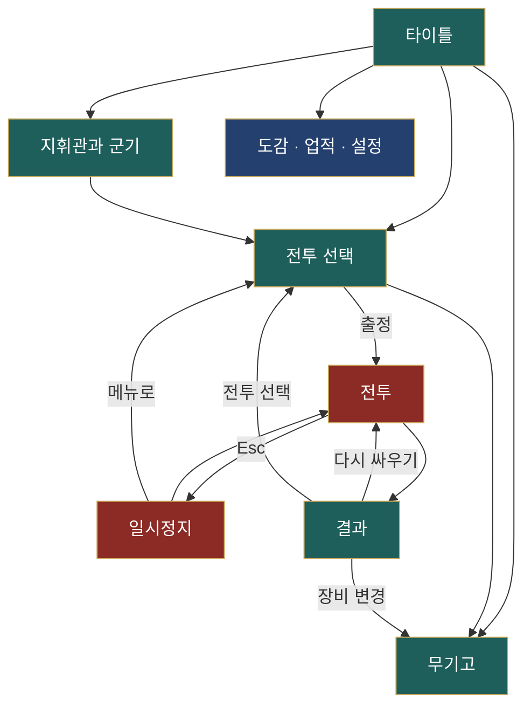

# 영웅의 전장 — 스무 개의 역사 전투

three.js 로 만든 3D 실시간 액션·부대 지휘 게임이다. 플레이어는 지휘관이 되어 직접 싸우는 동시에 여러 부대를 지휘해 역사 속 전투 20개를 치른다. 모든 화면과 메뉴는 한국어이고, 모델·문장·초상·효과음은 외부 에셋 없이 코드로 생성한다.

---

## 1. 주요 기능

| 영역 | 내용 |
|---|---|
| 전투 | 전술 역사 10개(열세의 병력으로 지형을 이용) · 영웅 무쌍 10개(소수 정예와 함께 적진 돌파) |
| 지휘관 | 4연타 공격, 힘 모으기 강공격, 무기 계열별 기술 Q·E·R·Y, 무쌍 필살기, 회피, 질주 |
| 무기 계열 | 검과 방패 · 대검 · 장병기 · 활·쇠뇌 · 법구 (계열이 기술 구성을 결정, 장비는 능력치 없음) |
| 부대 지휘 | 전선(본진·부장), 부대 카드 선택·인수·반환, 명령(전방 정렬·공격·돌격·고수·AI 위임), 진형 5종, 전술 지도 |
| 병종 | 19종(방패·검·창·돌격 보병, 활·쇠뇌, 돌격·습격 기병 계열과 정예 병종) |
| 전장 규칙 | 창 세우기의 돌격 저지, 방패 내구, 측면·후방 공격, 고지, 숲·진흙 감속, 강·다리·여울, 사기와 패주 |
| 승리 조건 | 깃발 유지 · 깃발 동시 유지 · 차례 점령 · 점령 후 귀환 · 패주 · 적장 격파 · 호위 |
| 카메라 | 휠·슬라이더 확대/축소(0.45~2.6배), 전술 지도, 상황 보정, 주요 사건 연출 샷(확대·궤도·슬로모션) |
| 성장 | 전투당 업적 5개(총 100개), 명예 점수, 금·은·동 훈장, 최고 기록 |
| 꾸미기 | 지휘관·군단 이름, 문장(분할 11 · 기하 문양 10 · 그림 45 · 4색), 초상 40종, 무기고(무기·갑옷·투구·망토·탈것·마갑) |
| 편의 | 키 재지정, 연출 카메라·자동 거리·화면 흔들림·효과 품질·피해 숫자·난이도·음량 설정, 터치(모바일 가로) 모드, 브라우저 저장 |

---

## 2. 실행

```bash
npm install
npm run dev      # 개발 서버 (http://localhost:5173)
npm test         # 단위·헤드리스 전투 테스트
npm run sim      # 전투 20개 헤드리스 시뮬레이션(균형 점검). 특정 전투만: npm run sim -- 1 11
npm run build    # 배포용 빌드 → dist/
npm run preview  # 빌드 결과 미리보기
```

요구 사항: Node.js 18 이상(Vite 6 기준), WebGL 을 지원하는 브라우저.

| 사용 기술 | 버전 |
|---|---|
| three.js | 0.180 |
| Vite | 6.x |
| 테스트 | `node:test` (Node 내장) |

---

## 3. 조작

| 구분 | 키 |
|---|---|
| 이동 · 질주 | W A S D · Shift |
| 공격 · 힘 모으기 | 좌클릭 · 우클릭 길게 |
| 기술 · 무쌍 · 회피 | Q E R Y · T · 스페이스 |
| 군대 명령 | C 전방 정렬 · V 커서 공격 · Z 돌격 · X 커서 고수 · B AI 위임/회수 |
| 진형 | F 방진 · G 원진 · H 쐐기진 · [ 장사진 · ] 공심방진 |
| 부대 선택 | \` 전선 선택 · 1–9 부대 선택(Shift 추가) · 0 선택 해제 |
| 화면 | 휠 확대/축소 · Tab 전술 지도 · Esc 일시정지 · F1 도움말 · F3 성능 표시 |

전술 지도에서는 좌클릭으로 부대를 선택하고 우클릭으로 이동·공격을 명령한다. 모든 키는 설정 → 키 설정에서 바꿀 수 있다.

---

## 4. 프로젝트 구성

시뮬레이션(`game/`, `core/`, `data/`)은 three.js·DOM 에 의존하지 않는 순수 JS 라서 Node 에서 그대로 돌려 테스트할 수 있다. 렌더러(`gfx/`)는 시뮬레이션 상태를 읽어 그리기만 하고, UI(`ui/`)가 입력·화면 전환·HUD 를 맡는다.

```
├─ index.html              진입 HTML
├─ public/crest.svg        파비콘
├─ src/
│  ├─ main.js              앱 진입, 화면 전환, 메인 루프
│  ├─ core/
│  │  ├─ rules.js          전투 규칙 순수 함수(상성·사상자·점령·승패·업적)
│  │  ├─ save.js           저장 데이터 검증·복구, 기본 키, 키 재지정
│  │  └─ audio.js          Web Audio 효과음 합성
│  ├─ data/
│  │  ├─ troops.js         병종 19종
│  │  ├─ weapons.js        무기 계열 5종·기술·무쌍, 무기고 장비
│  │  └─ battles.js        전투 20개(편성·전선·지도·목표·역사·전술·업적)
│  ├─ game/
│  │  ├─ map.js            지형 격자·높이·통행·A* 경로 탐색
│  │  ├─ unit.js           부대(중대)·대형·병사 인형
│  │  ├─ hero.js           지휘관(플레이어)·적 지휘관
│  │  ├─ ai.js             전선 AI(방어·공격·호위·추적)
│  │  └─ battle.js         전투 진행·교전·사격·거점·목표·명령
│  ├─ gfx/
│  │  ├─ stage.js          공용 WebGL 렌더러
│  │  ├─ models.js         절차적 로우폴리 모델, 진영 색 셰이더
│  │  ├─ art.js            문장·초상·부대 표지·이름표 캔버스 그리기
│  │  ├─ battleRenderer.js 지형·소품·군대(인스턴싱)·깃발·화살
│  │  ├─ effects.js        입자·베기 궤적·충격파·번개·피해 숫자
│  │  ├─ camera.js         카메라 연출기(추적·보정·연출 샷)
│  │  ├─ menuScene.js      타이틀 배경 3D 장면
│  │  └─ preview.js        지휘관 3D 미리보기
│  └─ ui/
│     ├─ dom.js            DOM 도우미·모달·토스트
│     ├─ styles.css        화면 디자인
│     ├─ menus.js          타이틀·지휘관과 군기·무기고·설정·키 설정
│     ├─ select.js         전투 선택·지형도
│     ├─ codex.js          전장 도감·업적
│     ├─ result.js         결과 화면
│     └─ battleView.js     전투 화면: 입력·HUD·카메라 연출 연결
├─ tests/
│  ├─ rules.test.js        규칙·저장 테스트
│  └─ battle.test.js       20개 전투 헤드리스 테스트
├─ scripts/sim-run.mjs     헤드리스 시뮬레이션(봇 지휘관 포함)
└─ docs/                   설계·레퍼런스 문서
```

의존 방향은 한쪽으로만 흐른다.

```
ui → game · gfx → core · data
```

한 프레임은 다음 순서로 처리된다.

```
입력 → 시뮬레이션(0.04초 단위 분할) → 이벤트(효과·소리·카메라 연출·기록) → 카메라 → 렌더 → HUD
```

화면 흐름은 아래와 같다.



---

## 5. 저장 데이터

브라우저 `localStorage` 의 `heroes-battlefield-save-v2` 키 하나에 지휘관 정보·문장·장비·전투 결과·설정·키 설정을 저장한다. 손상되거나 잘못된 값은 항목별로 기본값으로 복구하며, 저장이 막힌 환경에서는 메모리 상태로 계속 진행한다.

---

## 6. 문서

| 파일 | 내용 |
|---|---|
| [01-원본-개요.md](01-원본-개요.md) | 게임 개요와 두 가지 전투 방식 |
| [02-화면-구성.md](02-화면-구성.md) | 화면별 레이아웃·요소·동작 |
| [03-게임-시스템.md](03-게임-시스템.md) | 지휘관 전투, 군대·전선, 명령·진형, 상성, 승리 조건 |
| [04-데이터-레퍼런스.md](04-데이터-레퍼런스.md) | 병종·기술·지형·전투·업적 표 |
| [05-조작-체계.md](05-조작-체계.md) | 키·마우스·터치 조작 |
| [06-재구현-설계.md](06-재구현-설계.md) | 구조, 전투 공식, 카메라 연출, 리소스 생성, 저장, 결정 사항 |
| [07-검증-보고서.md](07-검증-보고서.md) | 테스트·시뮬레이션·브라우저 검증 결과 |
| [images/verification/](images/verification/) | 검증 스크린샷 |
